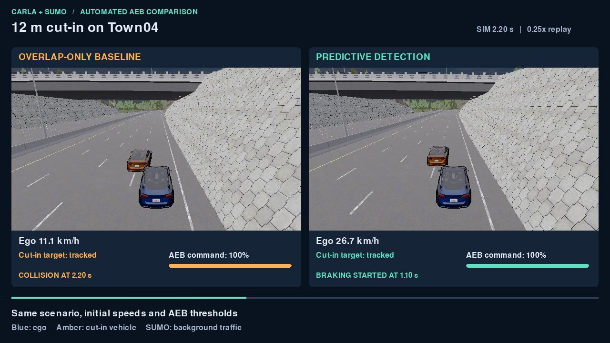

# CARLA AEB Autonomous Driving Simulation

## Project Overview

Autonomous driving simulation project based on CARLA 0.9.13, featuring lateral control (Stanley), longitudinal control (PID), and AEB (Automatic Emergency Braking) system validation.

The [longitudinal benchmark](docs/longitudinal.md) compares constant-speed
control with time-headway ACC under the same AEB policy. It includes JSON
scenarios, frame logs, development/holdout splits, and a separate runnable
OpenSCENARIO example.

## Tech Stack

- **Simulation**: CARLA 0.9.13
- **Language**: Python 3.7 + C++14
- **Lateral Control**: Stanley Controller (K=0.3, lookahead 8m)
- **Longitudinal Control**: PID (Python simple_pid + C++ extension, 1.7x speedup)
- **Safety System**: AEB 4-state FSM (Normal -> Warning -> Partial Brake -> Full Brake)
- **AI Integration**: ZhipuAI JSON scene -> CARLA auto-configuration
- **Testing**: pytest (42 AEB cases and a separate C++ PID suite)

## Project Structure

```
carla-aeb-autonomous-driving/
+-- controllers/          # Control algorithms
|   +-- stanley_pid_controller.py   # Stanley + PID + AEB + HUD
|   +-- pid_cpp_bridge.py           # C++ PID Python wrapper
|   +-- pid_cpp/                    # C++ PID source
+-- scenarios/            # Test scenarios
|   +-- aeb_validation_test.py      # AEB CCRb + Cut-in validation
|   +-- aeb_ccrb_headless.py        # AEB headless mode
|   +-- run_aeb_ccrb.py             # AEB subprocess wrapper
|   +-- run_cosim_aeb.py            # CARLA–SUMO AEB regression
|   +-- run_kml_demo.py             # KML mountain road driving
+-- tests/                # Unit tests
|   +-- test_aeb.py                 # AEB tests (42 cases)
|   +-- test_pid_cpp.py             # C++ PID tests (19/19)
+-- ai_integration/       # AI scene generation
|   +-- carla_ai_scene.py           # ZhipuAI JSON -> CARLA config
|   +-- smart_record.py             # Smart recording with retry
|   +-- auto_record_demo.py         # AI scene demo recording
+-- tools/                # Utility scripts
|   +-- generate_charts.py          # Data visualization
|   +-- screw_shell.kml             # Mountain road KML trajectory (142 points)
+-- docs/                 # Documentation & images
+-- output/               # Runtime output (gitignored)
```

## Quick Start

### Prerequisites

- CARLA 0.9.13 (precompiled)
- Python 3.7
- C++ compiler (MSVC for C++ PID extension)

### Setup

```bash
pip install -r requirements.txt
```

### Build C++ PID Extension (optional)

```bash
cd controllers/pid_cpp
python setup_pid_cpp.py build_ext --inplace
```

### Run AEB Validation Test

```bash
# Start CARLA server first, then run the test
python scenarios/aeb_validation_test.py
```

### Reproduce the CARLA–SUMO AEB comparison

Use the Windows precompiled CARLA 0.9.13 package, SUMO 1.18.0, and 64-bit
Python 3.7. The runner uses the Town04 network and bridge shipped with CARLA.
From the repository root in PowerShell, substitute your installation paths:

```powershell
$env:CARLA_HOME = 'D:\Carla_0.9.13'
$env:SUMO_HOME = 'D:\DLR\SUMO'
$env:PYTHONPATH = "$env:CARLA_HOME\PythonAPI\carla\dist\carla-0.9.13-py3.7-win-amd64.egg"
py -3.7 -m pip install numpy pygame opencv-python simple-pid lxml

# Start CARLA and wait for port 2000 to be ready.
Start-Process -FilePath "$env:CARLA_HOME\CarlaUE4.exe" -WorkingDirectory $env:CARLA_HOME -WindowStyle Hidden -ArgumentList '-RenderOffScreen','-quality-level=Low','-nosound'
py -3.7 "$env:CARLA_HOME\PythonAPI\util\config.py" --map Town04
py -3.7 scenarios/run_cosim_aeb.py
```

Run on an idle Town04 session. The script starts SUMO for each case, runs both
simulators at 50 ms per step, and restores the CARLA world settings afterward.
It writes a JSON summary and nine per-frame CSV files to `output/cosim-aeb/`.
The [reference run](docs/cosim_aeb_reference.json) was recorded with CARLA
0.9.13 and SUMO 1.18.0.

The two detection modes use the same AEB thresholds, initial ego speed of
12 m/s, scripted cut-in trajectory, and bridge seed of 42. The baseline
selects the target after its body overlaps the ego vehicle's travel corridor.
The predictive mode can select it earlier and keep tracking while the bodies
can still overlap.

| Initial cut-in offset | First brake, overlap only → predictive | Collision, overlap only → predictive |
| --- | --- | --- |
| 6 m | 2.45 s → 1.10 s | Yes → Yes |
| 12 m | 1.85 s → 1.10 s | Yes → No |
| 18 m | 1.85 s → 1.10 s | No → No |

In the 6 m case, both runs collided at 2.00 s. Ego speed in the last frame
before contact fell from 39.46 to 31.12 km/h with predictive detection.
In the same-lane brake check, the enabled run avoided collision with a
minimum estimated gap of 2.14 m. The adjacent-lane brake check triggered no
AEB command. The cut-in results apply to a kinematic target moving along the
scripted trajectory.

### Cut-in parameter sweep

```powershell
py -3.7 scenarios/run_cosim_aeb.py --sweep
```

The sweep crosses three initial longitudinal offsets (6, 12, and 18 m),
three ego target speeds (10, 12, and 14 m/s), and two scripted lane-change
durations (1.5 and 2.0 s). Each of the 18 combinations runs both detection
modes with the same settings, for 36 simulator runs. The 6-second observation
window, SUMO background traffic, and AEB thresholds remain fixed.

`output/cosim-aeb/sweep/` holds the per-frame CSVs, `summary.json`, and
`comparison.csv`. The frame logs include the target center's longitudinal
and lateral position relative to the ego vehicle. The comparison reports
first brake, first contact, and ego speed in the frame before contact.
Pairs without SUMO traffic or with a non-target collision are marked
invalid. Each remaining pair is classified by whether each mode collided
with the scripted target during the run.

In the [reference sweep](docs/cutin_sweep_reference.json), prediction
avoided contact in 2 of 18 pairs. Both modes collided in 6 pairs and
neither collided in the other 10. At a 12 m offset and 2.0 s lane change,
the 12 m/s case avoided contact with prediction. At 14 m/s, both modes
collided, but the ego speed in the frame before contact dropped from
45.16 to 38.00 km/h. In the 6 m, 14 m/s, 1.5 s case, neither mode
braked. The target center was 0.16 m behind the ego center at the start
of lateral motion, and 7.66 m behind at the end of the scripted
lane change. These results describe the scripted Town04 scenarios.

## Core Features

### Stanley Lateral Controller
- Cross-track error based steering
- Dynamic lookahead distance (8m)
- Steering smoothing (alpha=0.4)

### PID Longitudinal Controller
- Python `simple_pid` and C++ dual implementation
- C++ extension provides 1.7x speedup
- Output clipping [-1.0, 1.0]

### AEB State Machine
- 4 states: Normal -> Warning -> Partial Brake -> Full Brake
- One-way lock (can only escalate, not de-escalate)
- TTC + distance dual protection
- Distance protection (<10m forces full brake, 10m to <15m requires at least partial brake)
- The stronger demand from TTC and distance wins
- Vehicle body overlap with the ego's straight travel corridor filters out adjacent traffic
- Relative lateral motion can flag a vehicle predicted to enter that corridor within one second
- A tracked target stays eligible while its body can still overlap the ego vehicle, even after its center passes behind the ego's center

### Self-Monitoring and Adaptive Repair
- 7 monitoring items: collision, drift, stagnation, AEB failure, pygame, vehicle spawn, target behavior
- Quality adaptive degradation: Epic -> Medium -> Low
- Automatic parameter adjustment with up to 3 retries

## Testing

```bash
cd tests
pytest -v
```

Run `python -m pytest tests/test_aeb.py` from the project root to run the 42 AEB cases by themselves.

## Demo

### CARLA–SUMO 12 m Cut-in Comparison

[Watch the side-by-side MP4](docs/cosim_aeb_12m.mp4)



The third-person RGB cameras follow the ego vehicles in two live runs. The
overlay pairs each camera frame with the matching control log and marks the
collision using CARLA's collision sensor. The replay runs at quarter speed.
To record it again, use the co-simulation setup above with rendering enabled:

```powershell
py -3.7 -m pip install imageio-ffmpeg==0.5.1
py -3.7 scenarios/record_cosim_aeb.py
```

The recording and its measured results are saved under `output/cosim-aeb/`.

### AEB CCRb (Front Vehicle Emergency Brake)


### AEB Cut-in


### KML Mountain Road Driving


## TODO

- [ ] Add unit tests for Stanley controller
- [ ] Refactor hardcoded paths to environment variables
- [ ] Add CI/CD pipeline
- [ ] Add Docker support
- [ ] Document AEB threshold tuning methodology

## License

MIT License
