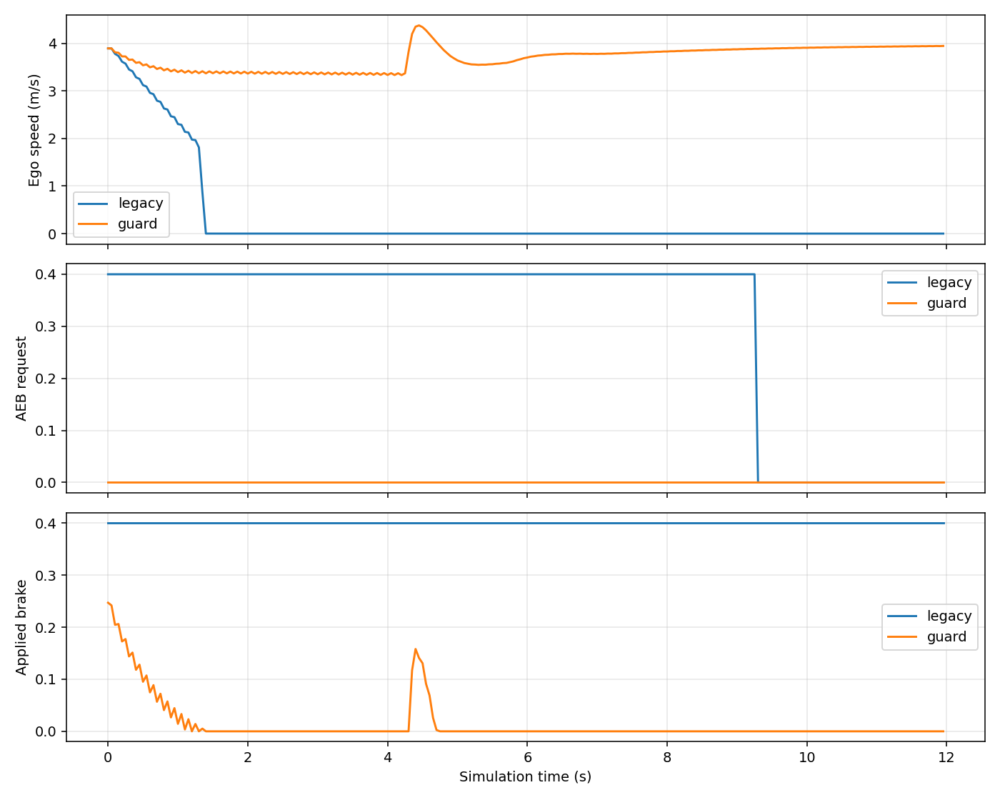
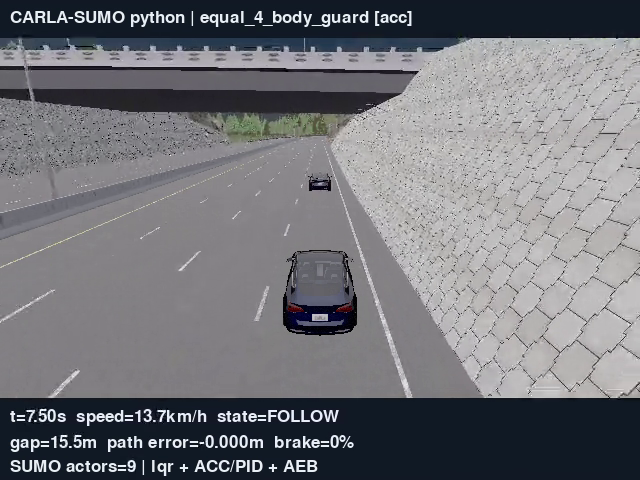

# AEB 追近窗口：低速误制动修正与评测边界

[完整结果](aeb_closing_reference.json) · [逐帧 CSV](aeb_closing_traces.zip) · [实际录像](aeb_closing_demo.mp4) · [原型失败记录](aeb_closing_prototype.json)

上一阶段发现：改用车身间距后，4 m/s 同速跟车会因距离小于 15 m 立即制动。本轮给距离保护增加追近窗口，检查低速误触发与急刹结果。默认 `closing_guard=False`，保留历史策略；新策略为显式开启的实验选项。

## 改动与未通过的原型

距离保护仍为 15 m 部分制动、10 m 全力制动，TTC 状态阈值仍为 2.5 / 1.6 / 0.6 s。新增条件仅作用于正间距下的距离保护：闭合速度大于 0.1 m/s，且 `间距 / 闭合速度 <= 5 s` 才允许距离条件升级。投影间距为 0 或负数时仍保留全力保护。原 TTC 分支独立运行，已经触发的制动不会因窗口不再满足而释放。

最初仅增加“闭合速度大于 0.1 m/s”条件，起始帧误制动消失，但在 4.60 s 再次误触发：间距 14.988 m、闭合速度 0.3765 m/s、TTC 39.808 s。这说明只排除零闭合速度不够。失败原型及 CSV 单独保留，不混入最终策略的 80 次主实验。

5 s 是利用既有低速误触发和高速诊断数据选定的实验常数，不是行业标准，不是停止距离模型，也没有估计前车加速度或路面附着。参数在主实验前冻结；首次用于本轮验证的速度/车距组合没有用于调参。

## 对照条件

两种策略均使用投影车身间距、固定 LQR、alpha=1、相同 PID/ACC/AEB 仲裁、CARLA 0.9.13 / SUMO 1.18.0、50 ms 步长和 seed 42。保持原场景有效性与功能验收规则，未为新策略放宽判据。

40 个配置各重复两次，共 80 次：历史 7 个 ACC 场景、1 个高速诊断场景、6 个历史急刹验证组合、4 个同速跟车组合、2 个本轮新增急刹组合，均比较无窗口与 5 s 窗口。

同速工况为 2 / 4 / 6 / 8 m/s，初始中心偏移分别为 18 / 18 / 18 / 28 m。本轮新增 2、6 m/s 同速跟车，以及自车 20 m/s、偏移 30 m和自车 24 m/s、偏移 38 m 的急刹场景，均在参数冻结后运行。历史标签只说明数据来源，不将旧数据重新称作未知测试集。



原策略在目标超出检测范围后可以将 AEB 请求清零，但外层锁定仍使实际制动保持；图中分别显示请求与实际制动，不能把请求曲线回零理解为车辆恢复行驶。

两轮结果一致：

| 同速初速 / m/s | 无窗口 | 5 s 窗口 |
|---:|---|---|
| 2 | t=0 误制动，fail | 无 AEB，pass |
| 4 | t=0 误制动，fail | 无 AEB，pass |
| 6 | t=0 误制动，fail | 无 AEB，pass |
| 8 | 无 AEB，pass | 无 AEB，pass |

原高速定速诊断在两种策略下均于 1.80 s 首次制动，观察期内无接触。历史 6 个及本轮新增 2 个急刹速度/偏移组合中，两种策略均为 4 组无接触、4 组接触；其中新增的 20 m/s、30 m 与 24 m/s、38 m 都仍接触。所测配置中没有新增碰撞，不能将这个结果外推到所有工况。

80 次运行均完成且满足场景有效性，其中 56 次功能通过、24 次功能失败。40 对重复运行的碰撞与功能判定一致，关键事件时刻差均为 0。审核结果的 `promotion_eligible=false`，不会把“没有新增碰撞”当作默认替换的充分条件。

## 如何解释功能判定

碰撞结果、功能验收与日志复算是三个不同结论。现有 hard_brake 用例要求 AEB 实际介入，即使 ACC 已避免接触，未触发 AEB 仍会被判 fail。本轮保留该规则，报告单列 `regressions`、`collision_regressions` 和 `promotion_eligible`，防止把“复算通过”误写成“功能全部通过”。

历史高速 ACC 工况中，原距离保护在 5.20 s 触发 AEB；窗口策略没有触发 AEB，两者均在观察期内无接触。后者仍按既有规则计为功能回退。这个差异需要进一步明确场景究竟验证 ACC 停车还是 AEB 介入，不能靠事后修改标签抹去。

原高速定速+AEB 诊断用例仍是独立的紧急制动检查，不与上述 ACC 处置用例混为一谈。剩余急刹接触和未覆盖的环境变化仍需继续评测，不能据本轮结果宣称 AEB 全面完成。

## 复现与检查

在 README 的仿真环境及空闲 Town04 上，将输出放在 D 盘仓库的新目录：

```powershell
py -3.7 scenarios/run_longitudinal.py --config configs/aeb_closing.json --lateral lqr --mode scene --output output/closing/a
py -3.7 scenarios/run_longitudinal.py --config configs/aeb_closing.json --lateral lqr --mode scene --output output/closing/b
py -3.12 scenarios/report_aeb_closing.py --input output/closing --output output/closing-report --plots
```

离线可解压逐帧 ZIP 到 output/closing 后执行最后一条。不加 --plots 无需 matplotlib。审核逐帧复算间距、TTC、状态与锁定，再比较重复运行事件；它不导入实际保护函数来生成预期值。控制器单测验证窗口边界、投影重叠、原 TTC 独立触发、制动锁定和默认策略兼容；另用历史误制动日志检查把旧数据错标为新策略时能被拒绝。

本轮不修改车身间距的几何近似、不标定实车制动能力、不将候选设为默认。个人练习应能解释：为什么 0.377 m/s 不能单独证明需要 AEB、为什么窗口关闭后已触发的制动仍保留，以及高速 ACC 的 fail 与碰撞之间的区别。开发由 AI 辅助完成。

本机 44 个实际 AEB 控制器单测通过，另通过纯 Python 边界、几何、输入与日志审核测试；80 条主实验日志在 Windows / Ubuntu 均复算通过，原 9 组实际 AEB 回归通过。34 秒 RGB 录像为 680 帧 / 20 fps，包含低速改动前、改动后和高速诊断三个片段，[逐段指标](aeb_closing_camera_reference.json) 与无摄像头结果一致。原型及录像的附加 CSV 放在 ZIP 的 prototype / camera 目录，不计入 80 次主实验。


