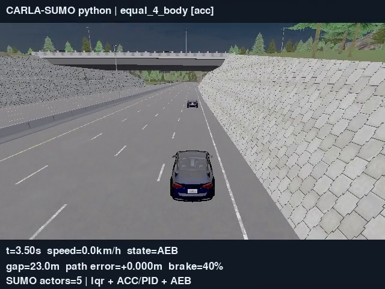
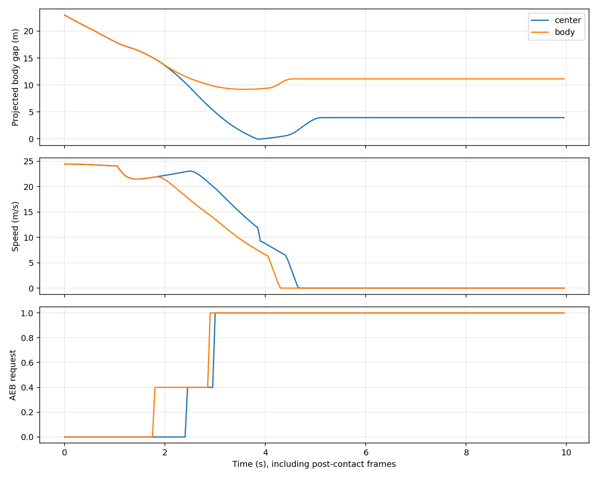

# AEB 距离定义：提前制动与误触发边界

[64 次运行结果](aeb_gap_reference.json) · [CSV 原始日志](aeb_gap_traces.zip) · [32 秒实际录像](aeb_gap_demo.mp4) · [录像逐段结果](aeb_gap_camera_reference.json)

上轮移除转向滤波后，高速工况仍在 3.90 s 追尾。本轮只比较 AEB 输入的距离定义：原来的沿路线中心距离，以及扣除车辆投影半长的车身间距。**诊断工况恢复为无接触，但低速同速跟车暴露了固定距离保护误触发，故保持默认策略不变。**



## 单变量与几何定义

使用 CARLA 0.9.13 / SUMO 1.18.0、50 ms 步长、seed 42、Tesla Model 3、物理前车和仿真真值。两组均使用固定 LQR、转向 alpha=1、相同 PID、ACC/AEB 仲裁、路线和场景初值。沿用上一阶段的 alpha=1 是为了排除已知越界干扰，本轮不再调横向参数。

原距离为目标与自车的路线站距差。实验间距扣除两车矩形沿各自局部路线切向的投影半长：`|forward·tangent| * extent.x + |forward×tangent| * extent.y`。目标仍按最近前方中心距离选择，未改变目标身份筛选规则。允许负间距，以保留投影重叠证据。

该间距是平面矩形投影近似，使用当前 Tesla 的 actor 原点与包围盒半长，不是三维车身之间的精确最短距离；包围盒原点偏移、滚转等未建模。ACC 原有 gap 和场景有效性规则没有改变。

AEB 阈值固定为 TTC 2.5 / 1.6 / 0.6 s，部分/全力制动请求 0.4 / 1.0，距离小于 15 / 10 m 的保护仍保留。算法只升级制动等级，外层仲裁在本次用例内锁定紧急制动。`aeb_distance_reference=body` 只用于 route 目标选择；其他入口拒绝使用，避免混淆不同距离定义。

## 诊断工况：哪里变早了

自车 25 m/s、前车 20 m/s、初始偏移 30 m、1 s 前车急刹、定速 PID+AEB，观察 10 s。两轮结果一致：

| 项目 | 中心距离 | 投影车身间距 |
|---|---:|---:|
| 首次制动 / s | 2.45 | 1.80 |
| 首次全力制动 / s | 3.00 | 2.90 |
| 首次全力制动时自车速度 / m/s | 19.67 | 14.34 |
| 同帧投影车身间距 / m | 4.962 | 9.988 |
| 首次接触 / s | 3.90 | 观察期内未接触 |
| 功能判定 | 有效、fail | 有效、pass |

原版本在中心距离约 9.76 m 时才进入 10 m 保护，实际投影间距已不足 5 m。车身间距版本的首次部分制动发生于间距 14.85 m、TTC 2.69 s，首次全力制动发生于间距 9.99 m、TTC 4.02 s；这两次升级都由**固定距离保护**触发，而不是 TTC 阈值。早期部分制动使进入全力制动时的速度降低，不能只比较全力制动提前了 0.1 s。



图保留完整观察窗口，含中心距离版本接触后的帧；接触后的运动不再是相同前车输入，不能据此作正常跟车性能比较。

## 冻结参数后的适用范围

两种距离定义各运行两轮：原 7 个弯道 ACC 工况、上述诊断工况、6 个新速度/偏移组合、2 个同速跟车负对照，共 64 次。新急刹组合在原开发弯道 spawn 185 上运行，未用这些结果调整参数；历史标签不代表全新的道路测试集。

| 新急刹初速 / m/s | 初始偏移 / m | 中心距离 | 车身间距 |
|---:|---:|---|---|
| 18 | 26 | 接触 | 未接触 |
| 18 | 34 | 接触 | 接触 |
| 22 | 26 | 接触 | 未接触 |
| 22 | 34 | 接触 | 接触 |
| 28 | 26 | 接触 | 未接触 |
| 28 | 34 | 接触 | 未接触 |

这 6 组在两种定义下均满足场景有效性。结果不支持“修正距离即可覆盖所有急刹”。原 7 个 ACC 回归在两种定义、两轮重复中均通过。

同速负对照使用直路 spawn 269，初速 4 / 8 m/s、初始偏移分别为 18 / 28 m。4 m/s 工况中，中心距离版本通过；车身间距版本在 t=0 即请求 0.4 制动，最终功能失败。该帧实际闭合速度约 −0.000008 m/s，TTC 为无穷大，投影间距 13.208 m，触发的是不依赖闭合速度的 15 m 保护。8 m/s 工况两种定义均通过。

因此本轮候选版本既有改善，也有明确副作用。固定距离保护、TTC、制动锁定需要一起重新设计，不能仅把阈值单位换成车身间距便宣布完成 AEB 改进。剩余两个急刹接触和同速误制动均保留在原始数据中。

## 审核与复现

32 对重复运行的碰撞、有效性与功能判定一致，首次制动、全力制动、接触和事件时刻差均为 0。离线脚本独立复算功能指标，逐帧检查距离口径、TTC、状态机等级及仲裁锁定。日志的无穷大 TTC 保存为 CSV 的 inf；JSON 快照以 null 表示没有有限 TTC，可结合闭合速度复核。

速度差分得到的瞬时减速度最高约 26.9 m/s²，属于本仿真输出，不能作为实车制动能力标定。该尖峰在诊断车身间距用例 4.20 s 出现（相邻速度 3.712→2.369 m/s），不据此反推恒定制动距离或声称舒适性改善。

几何与输入验证、日志损坏拒绝测试通过。32 秒 RGB 录像共 640 帧，覆盖中心距离追尾、车身间距无接触、低速误制动；三段关键指标均与无摄像头实验相同。

在 README 的环境与空闲 Town04 上，输出到 D 盘仓库的新目录：

```powershell
py -3.7 scenarios/run_longitudinal.py --config configs/aeb_gap.json --lateral lqr --mode scene --output output/gap/a
py -3.7 scenarios/run_longitudinal.py --config configs/aeb_gap.json --lateral lqr --mode scene --output output/gap/b
py -3.7 scenarios/run_longitudinal.py --config configs/aeb_gap_equal_speed.json --lateral lqr --mode scene --output output/gap/equal-a
py -3.7 scenarios/run_longitudinal.py --config configs/aeb_gap_equal_speed.json --lateral lqr --mode scene --output output/gap/equal-b
py -3.12 scenarios/report_aeb_gap.py --input output/gap --output output/gap-report --plots
```

离线可解压原始日志 ZIP 至 output/gap，直接执行最后一条命令。不加 --plots 无需 matplotlib；CI 在 Linux 执行同样审核。开发由 AI 辅助完成，个人应能从 CSV 解释 1.80 / 2.45 s 的不同触发来源，并定位 t=0 的误制动条件。
