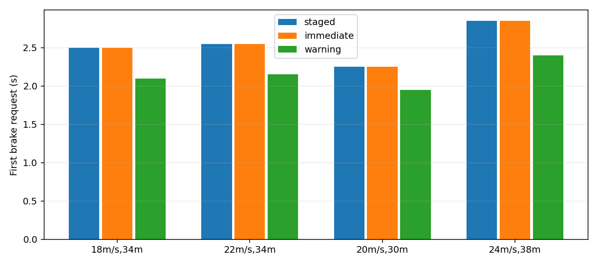

# AEB 制动力与介入时机对照

[逐工况结果](brake_onset_reference.json) · [原始日志](brake_onset_traces.zip) · [实际对照录像](brake_onset_demo.mp4)

四个已知追尾工况中，在原首次部分制动时刻直接请求全力制动，仍然接触。将全力制动提前到原 2.5 s TTC 预警阈值后，四组在各自 12 s 观察期内均无接触，两轮结果一致。原始场景、目标选择、5 s 距离保护窗口、固定 LQR、转向 alpha=1、纵向 PID 和制动锁定相同。

## 三种请求策略

- staged 使用原 TTC 2.5 / 1.6 / 0.6 s 阈值及 0.4 / 1.0 部分与全力请求。
- immediate 令部分制动等级输出 1.0，首次介入时刻与 staged 相同。
- warning 将全力等级 TTC 阈值设为 2.5 s，距离保护仍可能更早触发原部分等级。该设置对应实验字段 full_brake_at_warning。

immediate 的 aeb_level 可以为 2，同时请求值为 1.0。日志审核分别检查等级与实际请求。首次全力请求只说明指令值，车辆实际减速度由仿真物理决定。

| 初速 / m/s，初始偏移 / m | staged 首次制动 / s | immediate 首次制动 / s | warning 首次制动 / s | staged 接触 / s | immediate 接触 / s | warning 接触 |
|---|---:|---:|---:|---:|---:|---|
| 18，34 | 2.50 | 2.50 | 2.10 | 3.95 | 4.10 | 观察期内无接触 |
| 22，34 | 2.55 | 2.55 | 2.15 | 4.35 | 4.55 | 观察期内无接触 |
| 20，30 | 2.25 | 2.25 | 1.95 | 3.95 | 4.10 | 观察期内无接触 |
| 24，38 | 2.85 | 2.85 | 2.40 | 4.75 | 4.90 | 观察期内无接触 |



immediate 的接触前闭合速度约为 6.47 / 6.37 / 5.85 / 7.07 m/s，staged 分别约为 7.90 / 8.12 / 7.54 / 8.65 m/s。这些数值来自碰撞回调前最后一个采样帧的路线投影相对速度，存在 50 ms 采样间隔。

## 检查与适用范围

7 个工况、3 种策略、各重复两次，共 42 次运行。每种策略的两轮关键结果和事件快照一致。审核逐帧复算功能结果与状态机，并要求 staged / immediate 的介入前历史完全相同。warning 与其余策略在首次策略差异前的车速、间距、闭合速度、横向误差、转向均一致，配置仅有实验字段差异。

4 m/s 同速跟车在三种策略下均无 AEB，原高速定速诊断均无接触。历史高速 ACC 工况三种策略均未触发 AEB，按原要求仍为 fail。验收定义沿用原版本。

24 秒 RGB 录像共 480 帧，展示 18 m/s、34 m 工况的 staged 与 warning 两段实际运行。[录像指标](brake_onset_camera.json) 与批量运行一致。逐帧复算及配对审核在 Windows / Ubuntu 均通过。

四个追尾场景来自已分析的失败集合。2.5 s 直接采用既有预警阈值，本轮未搜索阈值。结果支持这些配置下更早全力介入能避免接触，后续还需在独立场景中评测误制动、制动强度和舒适性。实际入口以实验配置开启，项目技能描述应同时交代这项验证范围。

## 复现

使用 README 的 CARLA 0.9.13 / SUMO 1.18.0 环境及空闲 Town04，固定 50 ms 步长。输出放在 D 盘仓库的新目录。

```powershell
py -3.7 scenarios/run_brake_onset.py --output output/onset
py -3.7 scenarios/run_brake_onset.py --warning --output output/warning
py -3.12 scenarios/audit_brake_onset.py output/onset --warning-folder output/warning
```

ZIP 中 staged 包含原策略及同刻全力策略的 28 次运行，warning 包含提前全力策略的 14 次运行。离线解压到 output/replay 后，将审核命令两个输入改为 output/replay/staged 与 output/replay/warning。CI 执行同样审核，依赖纯 Python 和项目原评测模块。

开发由 AI 辅助完成。个人练习可从 18 m/s、34 m 的 CSV 解释 2.10 / 2.50 s 之间发生了什么，再说明同刻加大制动为何只推迟了接触。
