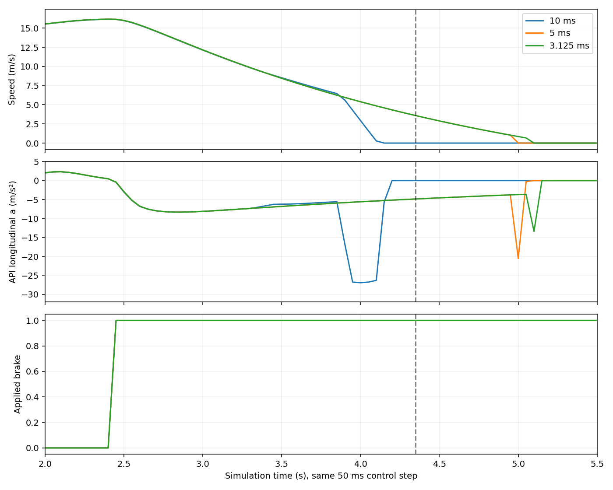

# AEB 制动尖峰的物理步长诊断

[30 次运行与逐帧数据](brake_physics_traces.zip) · [指标及重复时刻复算](brake_physics_reference.json) · [留出运行前声明](brake_physics_manifest.json) · [冻结配置](../configs/brake_physics_holdout.json)

## 证据与结论

对已知 brake_0 的分级、提前全力两种策略，分别以 10、5、3.125 ms 物理子步运行两轮。控制和日志步长均为 50 ms。另在三个新速度、初始偏移和触发时间组合上，固定提前全力策略，比较同样三种子步，各运行两轮。共 30 次有效运行、15 对重复，目标选中、场景事件、AEB 和接触时刻的重复差均为 0。

默认子步的 brake_0 提前全力策略在 2.40 s 请求全制动，2.45 s 的状态中已应用全制动。3.90–4.10 s 的低速阶段出现减速度突增，4.00 s 速度差分为 −26.94 m/s²，CARLA 纵向加速度接口同时给出 −26.94 m/s²。期间制动保持 1、挡位保持 1、帧号连续，仿真时间每帧推进 50 ms。补充诊断表明该异常持续数帧，修正了先前“单帧尖峰”的描述。接口与差分都依赖引擎状态，其一致性支持排查记录错位，仍需用其他证据检验车辆物理模型。



图中虚线为旧共同窗口的 4.35 s 截止时刻。加速度面板显示 2–5.5 s 的制动阶段。起步初始化的速度设置不在图示区间，jerk 统计排除前 1 秒。

| brake_0 提前全力策略 | 10 ms | 5 ms | 3.125 ms |
|---|---:|---:|---:|
| 峰值速度差分减速度 / m/s² | 26.94 | 20.54 | 13.41 |
| 峰值时刻 / s | 4.00 | 5.00 | 5.10 |
| 停车时刻，速度低于 0.1 m/s / s | 4.15 | 5.00 | 5.10 |
| 原 4.35 s 窗口 jerk RMS / m/s³ | 67.27 | 20.95 | 21.56 |
| 完整 12 s 窗口 jerk RMS / m/s³ | 37.12 | 37.30 | 25.33 |
| 观察期内接触 | 无 | 无 | 无 |

仅比较旧窗口会把 5 ms 的 jerk 降幅表述为约 69%，但 5 ms 的减速度尖峰移到了窗口之后，完整过程的 jerk 与 10 ms 基本相当。因此本轮以两种时间窗口共同报告。保持控制指令与控制周期时，仅改变物理子步就改变了低速减速度，说明结果对物理积分设置敏感。5 ms 与 3.125 ms 间仍有明显差异，当前数据尚未证明数值收敛。轮胎、制动或其他 PhysX 子模块中究竟哪一项导致变化仍待定位。

## 新组合验证与适用范围

留出配置先提交于 e72f89a，之后运行。三个组合分别为自车/前车初速 18/14、22/16、26/20 m/s，初始沿路偏移 32、38、40 m，触发时间 1.5、1.9、1.2 s。目标车启用物理，使用仿真真值选目标。

| 组合 | 物理子步 / ms | 完整窗口 jerk RMS / m/s³ | 最近沿路径车身间距 / m |
|---|---:|---:|---:|
| 0 | 10 / 5 / 3.125 | 37.76 / 37.73 / 25.26 | 6.69 / 7.73 / 7.69 |
| 1 | 10 / 5 / 3.125 | 37.87 / 27.23 / 21.14 | 1.16 / 1.13 / 1.10 |
| 2 | 10 / 5 / 3.125 | 43.58 / 28.28 / 23.24 | 11.07 / 11.81 / 11.76 |

这 18 次运行均满足现有场景有效性和功能判据，观察期内无接触。组合 1 仍只有约 1.1 m 间距，结论限于本批设置与观察期。本轮的 jerk 差异来自仿真物理设置实验，算法性能需要固定车辆模型与数值设置后再评价。

开发阶段另尝试了 2.5 ms 子步，需要 20 个子步，而 CARLA 的有效上限为 16。这四次超限运行排除，保留在本机 output/brake-diagnosis/substep25-*。入口现已在连接仿真前拒绝此类配置。留出声明首次保存的哈希使用 Windows CRLF 字节，报告保留该原哈希并新增仅统一 CRLF 为 LF 的哈希，便于 Linux 复算，场景参数保持已声明值。

## 复现

在仓库根目录，用纯 Python 离线审核，逐例复算已有指标、检查帧号、时间戳、前一帧请求与当前实际控制、物理子步一致性和重复事件。可选绘图需要 matplotlib。

```bash
python -m zipfile -e docs/brake_physics_traces.zip output/brake-physics-audit
python scenarios/report_brake_diagnostics.py output/brake-physics-audit output/brake-physics-report
python -m unittest discover -s tests -p test_brake_diagnostics.py -v
```

真实复跑遵循主 README 的 CARLA 0.9.13 / SUMO 1.18.0 / Python 3.7 环境，在空闲 Town04 运行。两次使用不同输出目录。

```powershell
python scenarios/run_longitudinal.py --config configs/brake_physics_holdout.json --mode scene --lateral lqr --output output/brake-physics-new-a
python scenarios/run_longitudinal.py --config configs/brake_physics_holdout.json --mode scene --lateral lqr --output output/brake-physics-new-b
```

开发组的实际配置保存在各批 summary.json 内。原分级策略在三个子步设置下均发生接触，真实失败随原始日志一起保留。默认实验通过可选配置开启诊断和子步变更，其他调用沿用既有设置。

另外实跑原有九组回归，首次 AEB 时刻与前车接触判定逐项复现历史参考。Windows 通过诊断、纵向和恢复相关 19 项测试；WSL Ubuntu 跑通更新后的全部 offline.yml 测试与历史日志复算。[九组本轮结果](brake_physics_regression.json) · [历史参考](cosim_aeb_reference.json)

CARLA 文档要求控制步长不超过子步时长乘子步数，并说明物理子步对速度和加速度结果的影响。[同步与物理子步](https://carla.readthedocs.io/en/0.9.13/adv_synchrony_timestep/) · [加速度接口](https://carla.readthedocs.io/en/0.9.13/python_api/#carla.Actor.get_acceleration)
