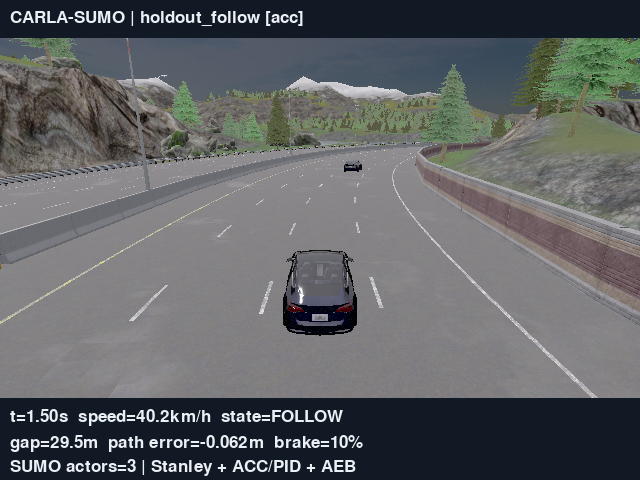

# CARLA-SUMO 弯道跟车、减速及急刹联合验证

[实际相机演示（48 秒）](curved_demo.mp4) · [完整结果](curved_reference.json) · [逐帧证据](curved_traces.zip)



## 场景及固定参数

Town04 的出生点 185（左弯）用于开发，209（右弯）用于留出验证。沿前进方向 50 m，地图航向变化约为 −15.9°、+17.8°。两条路线均使用物理车辆，前车通过同一套前轴 Stanley 沿固定车道行驶。控制增益沿用既有冻结值，未在留出工况调参。

开发自车速度为 9 m/s，留出为 12 m/s，稳定跟车前车速度分别为 8、10 m/s，普通初始中心偏移为 35、40 m。缓减速在 3 s 触发。常规急刹在 1 s 触发，初始中心偏移为 18、22 m。另增加自车 25 m/s、前车 20 m/s、初始中心偏移 30 m 的高速压力用例。全量输入见 configs/curved.json。

## 目标选择与距离

原来的直线走廊判定会在弯道丢失同车道前车，开发跟车样例直到 7.15 s 才选中前车。在开发/留出的跟车和缓减速四例中，它的目标覆盖率约为 49%、50%、25%、43%。

新策略使用仿真真值，将所有候选车辆投影到自车固定参考路线。只考虑沿路线前方 50 m 内、与路线方向夹角小于约 60°、车身横向位置与走廊重叠的候选，选择沿路最近对象。检查相邻车道、后方、反向和范围外车辆的单元测试已加入 CI。

ACC 在两种曲线对照策略中均使用沿路线距离减车身半长之和作为近似车距。路线策略按各自路线切向计算相对速度，并把沿路中心距离和闭合速度交给既有 AEB 状态机；走廊对照保留原速度投影。TTC、固定距离保护和制动优先级保持原参数。直路默认继续使用原走廊策略，避免改变已有切入预测行为。

这些计算依赖二维固定路线和真值状态。本轮未验证立交桥高度区分、感知误差或未知路线，沿路车距也不是精确的弯道车身几何接触判据，接触仍由碰撞传感器独立判定。

## 常规结果

| 工况 | 目标覆盖率 | 自车最大路径偏差 m | 前车最大路径偏差 m | AEB 首次制动 s | 接触 |
|---|---:|---:|---:|---:|---|
| 开发跟车 | 100% | 0.046 | 0.013 | 无 | 无 |
| 开发缓减速 | 100% | 0.046 | 0.020 | 无 | 无 |
| 开发急刹 | 100% | 0.046 | 0.020 | 6.95 | 无 |
| 留出跟车 | 100% | 0.064 | 0.041 | 无 | 无 |
| 留出缓减速 | 100% | 0.066 | 0.070 | 无 | 无 |
| 留出急刹 | 100% | 0.037 | 0.069 | 8.50 | 无 |

两轮功能结果、是否接触及关键事件时刻一致。常规急刹中，ACC 先行减速，AEB 随后主要由固定距离保护介入。例如留出急刹的首次 AEB 时自车仅约 0.57 m/s。因此这些结果主要验证协同及优先级，不能据此宣称已经覆盖高速紧急制动。

覆盖率仅统计接触前、前车沿路距离在 0–50 m 内的样本。常规跟车、缓减速要求覆盖率至少 95%。本轮另设前车路径偏差不超过 0.50 m、自车实际转弯至少 2°作为有效性条件，均为工程检查阈值，未引用法规标准。输入急刹还从原始车速确认触发后至少下降 1 m/s，且该证据早于首次接触；日志中的 event_observed 对急刹仍保留前车停车观测。

## 高速压力与真实失败

高速 ACC 用例保持目标跟踪，未发生接触。另用定速加 AEB 的对照主动检验紧急制动。两种目标策略均在 2.45 s 首次请求部分制动、3.00 s 请求全力制动，3.85 s 发生接触，前一帧自车约 44.3 km/h。路线策略的目标覆盖率为 100%，原走廊约 84.4%，但这一变化没有避免接触。

该定速失败重复运行的制动及接触时刻一致。前车接触前最大路径偏差约 0.295 m，自车约 0.547 m，输入路线条件有效。既有 AEB 阈值、制动响应和初始车距的影响仍需单独分析，本轮没有调整它们。

演示前三段为留出跟车、缓减速和常规急刹的 ACC 运行，最后一段明确标记 baseline，展示高速定速加 AEB 的接触。标签、车速、近似沿路车距和控制状态均来自对应帧日志。

## 回归、测试与复现

本次共完成 24 次弯道运行（两种策略、重复验证与定速压力对照），另跑 20 次直路回归。直路的功能判定、是否接触及关键事件与冻结的 integrated_reference.json 一致。29 项离线单元测试通过。Windows 和 WSL Ubuntu 均可从 CSV 重算结果。

在已有 CARLA 0.9.13、SUMO 1.18.0 环境，启动空闲 Town04 后运行，输出目录需为新目录。

```powershell
py -3.7 scenarios/run_curved.py --output output/curved-release-01
```

该入口依次执行对照、重复运行、直路回归和实际相机录像，最后生成 report.md 与 reference.json。各步骤已经实际运行并核对。也可单独运行留出场景。

```powershell
py -3.7 scenarios/run_longitudinal.py --config configs/curved.json --split holdout --mode acc --output output/curved-check
```

将证据包解压到 output/curved-from-zip，可在没有 CARLA SDK 的 Python 标准库环境下复核。

```bash
python3 scenarios/report_curved.py --input output/curved-from-zip
```
