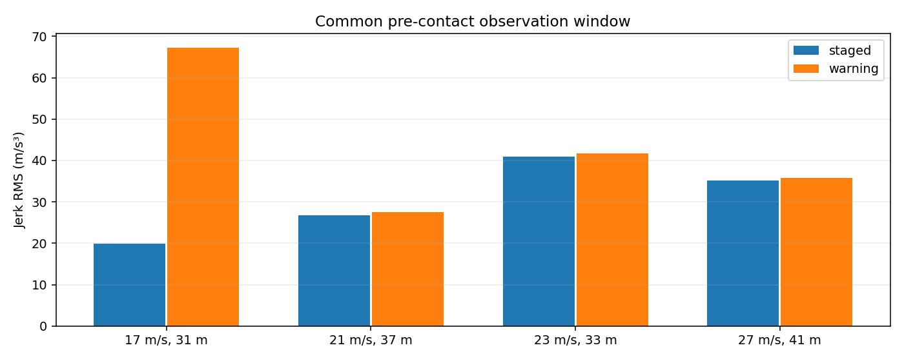

# 冻结参数后的独立场景验证

[运行前声明](independent_aeb_manifest.json) · [冻结配置](../configs/independent_aeb.json) · [逐工况结果](independent_aeb_reference.json) · [原始 CSV](independent_aeb_traces.zip) · [实跑录像](independent_aeb_demo.mp4)

本轮固定原分级策略和 2.5 s TTC 提前全力策略，使用 16 个新速度、车距与触发时间组合，各运行两轮，共 64 次。运行前已将配置及验收条件提交为 c2da794。参数源自上一阶段，过程中没有根据结果修改阈值。

配置 SHA256 为 909afdcfa541769e112132a84e62bc6567d24d53d182dbbc2c10084c340fd32a。离线审核同时检查此哈希和每次实际运行的配置。Town04 路段和车型沿用历史设置，独立性针对新工况组合。

## 验证结果

提前全力策略的 16 个场景两轮均通过预声明条件，原分级策略 12 个通过、4 个急刹接触。所有运行均满足场景有效性，32 对重复的关键事件时刻差均为 0。

| 工况 | 原分级 | 提前全力 | 原分级首次 AEB / s | 提前全力首次 AEB / s |
|---|---|---|---:|---:|
| brake_0 | fail | pass | 2.8 | 2.4 |
| brake_1 | fail | pass | 2.6 | 2.45 |
| brake_2 | fail | pass | 2.65 | 2.35 |
| brake_3 | fail | pass | 2.15 | 1.85 |
| follow_0 | pass | pass | None | None |
| follow_1 | pass | pass | None | None |
| follow_2 | pass | pass | None | None |
| slow_0 | pass | pass | None | None |
| slow_1 | pass | pass | None | None |
| slow_2 | pass | pass | None | None |
| adjacent_0 | pass | pass | None | None |
| adjacent_1 | pass | pass | None | None |
| cutout_0 | pass | pass | None | None |
| cutout_1 | pass | pass | None | None |
| cutin_0 | pass | pass | 2.3 | 2.3 |
| cutin_1 | pass | pass | 2.8 | 2.8 |

3 个稳定跟车、3 个缓减速、2 个邻道及2 个切出在两种策略下均无 AEB，切出均恢复巡航。切入与切出的目标为运动学控制，其他场景使用物理前车。

### 急刹共同窗口的平顺性

| 工况 | 原分级 jerk RMS / m/s³ | 提前全力 jerk RMS / m/s³ | 共同窗口结束 / s |
|---|---:|---:|---:|
| brake_0 | 19.95 | 67.27 | 4.35 |
| brake_1 | 26.72 | 27.52 | 4.25 |
| brake_2 | 40.93 | 41.66 | 4.05 |
| brake_3 | 35.10 | 35.76 | 3.65 |



4 个急刹组合的共同窗口 jerk RMS 均增加。brake_0 的候选版本峰值差分减速度约 26.94 m/s²，含明显单帧尖峰，因此本轮功能通过不能直接解释为实车舒适性通过。该问题保留在展示版本的限制说明中。

## 工况与验收

场景包括 4 个急刹、3 个稳定跟车、3 个缓减速、2 个邻道、2 个切出及 2 个切入。固定 seed 42、50 ms 步长、投影车身间距、5 s 追近窗口、固定 LQR 和 alpha=1。两种策略仅 full_brake_at_warning 字段不同。

急刹用例要求场景有效、无接触、选中目标且 AEB 介入。跟车、缓减速及邻道要求场景有效、无接触且无 AEB。切出还需恢复巡航，切入要求场景有效、无接触且选中目标。以上沿用既有指标逻辑，失败和无效结果均保留。

急刹、跟车、缓减速、邻道使用启用物理的前车。切入与切出沿用已有运动学目标，其位置按配置推进，属于受控目标选择验证。

## 平顺性与复算方法

碰撞使用实际传感器回调，接触前间距使用项目原投影指标。两种策略采用共同的时间终点，即两者首次接触时刻的较早者，均无接触时取观测结束。速度差分得到纵向加速度，再差分得到 jerk，步长为 0.05 s。jerk RMS 排除初始 1 s，峰值减速度保留完整共同窗口。

原始摘要仍保留各次运行自身接触前的指标，配对平顺性指标另在 common_window_comfort 字段中保存。仿真差分尖峰会影响这些数值，结果用于本次对照，不作实车舒适性标定。

brake_0 的尖峰对应 4.00 s，自车速度由上一帧的 4.284 m/s 变为 2.937 m/s。原始采样值保留在 CSV 中。

审核复算每帧距离定义、TTC、状态等级、制动请求和仲裁锁定，检查两种策略首次介入前的状态一致，再比较重复运行的功能判定、碰撞和事件时刻。CI 审核数据和复算一致性，场景功能结果见逐工况结果。

## 复现

在 README 的 CARLA 0.9.13 / SUMO 1.18.0 环境及空闲 Town04 上运行，输出到 D 盘仓库的新目录。

```powershell
py -3.7 scenarios/run_longitudinal.py --config configs/independent_aeb.json --lateral lqr --mode scene --output output/independent/a
py -3.7 scenarios/run_longitudinal.py --config configs/independent_aeb.json --lateral lqr --mode scene --output output/independent/b
py -3.12 scenarios/report_independent_aeb.py --input output/independent --output output/independent-report
```

离线可解压 ZIP 到 output/independent 后运行最后一条。Windows 和 Ubuntu 使用相同入口。

64 条主实验日志在 Windows / Ubuntu 均复算通过。40 秒 RGB 录像共 800 帧，展示原急刹接触、候选急刹无接触及缓减速跟车三个片段，[录像指标](independent_aeb_camera_reference.json) 与批量实验一致。录像附加日志保存在 ZIP 的 camera 目录。

## 个人独立练习

工程由 AI 辅助完成，个人掌握状态为待本人演示。

1. 从 a/brake_0_staged_baseline.csv 找出第一次 AEB 请求和第一次全力请求，在 a/summary.json 找到接触时刻。说明每帧目标身份，并用间距和闭合速度解释触发原因。
2. 把冻结配置复制到 output/practice，选择一个场景修改车距。运行前写下对首次制动和最小间距的预测及理由，运行后用 CSV 检查。保留冻结配置用于复算。
3. 自行实现一个判断距离保护是否允许触发的小函数，覆盖正间距、闭合速度小于等于 0.1、追近时间恰好 5 s 和投影重叠。解释这个函数与 TTC 状态机、外层制动锁定的关系。

三项练习需要本人独立完成，使用 AI 提示的部分可记录下来作为下一次练习内容。
