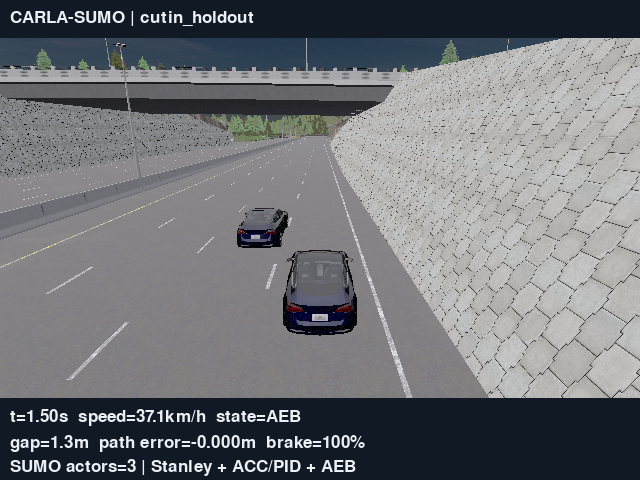

# CARLA-SUMO 横纵向控制集成展示版

[六类场景实际相机演示（68 秒）](integrated_demo.mp4) · [完整评测结果](integrated_reference.json) · [逐帧证据压缩包](integrated_traces.zip)



## 主流程

自车使用修正后的前轴 Stanley，增益 2.0、归一化转向限幅 0.7、平滑系数 0.4。启动时沿地图车道采样固定参考路径，避免每帧跟着自车所在位置重新定义目标车道。沿用已冻结的恒定时距 ACC、速度 PID 和 AEB 优先级。AEB 锁定后油门为 0，制动不低于锁定请求，保持至本次观察结束。物理前车仍使用既有控制策略，以便比较相同输入场景。

每帧先提交自车及物理前车的控制批次，再由原有 SUMO 同步桥唯一推进 50 ms 仿真时钟。日志同时记录车距、目标、横向路径偏差、航向偏差、转向、油门、制动、CRUISE/FOLLOW/AEB 状态和 SUMO 背景车辆数。

原入口保留 --lateral legacy，默认 --lateral stanley，另有 --lateral lqr。LQR 使用权重 0.2、以巡航速度设计固定增益，未增加在线模型辨识。转向控制适配器共用此前单项实验的控制律与折线投影代码。

## 实测回归

本次完成 70 次主流程仿真，包括旧横向控制的 20 次、Stanley 的 20 次及其重复 20 次、LQR 的 10 次 ACC 对照。另独立运行原有 9 组 AEB 回归和六类相机演示。

- 与历史纵向结果比较，以及旧横向与新 Stanley 比较，有效性、功能判定、是否碰撞及关键事件均无超过一步的变化。
- Stanley 两轮的目标选择、事件发生、首次 AEB、首次碰撞时刻差均为 0 s。
- LQR 的 10 次 ACC 运行在上述功能指标上与 Stanley 一致。
- 原有 9 组 AEB 的是否接触、首次制动和首次接触时刻与冻结参考相同。连续碰撞回调次数单独保留，不作为碰撞工况数。
- 逐帧复核 AEB 优先级及 SUMO 背景存在，CSV 复算指标与汇总相同。WSL Ubuntu 中也完成离线复核。
- 主流程的 20 个 Stanley 结果均为有效场景。跟车、减速、切出、普通切入和邻道 ACC 工况通过；下列已知失败保留。

留出跟车和前车减速的稳态车距 RMSE 约为 1.141 m、0.909 m，接触前最大路径偏差约为 0.00144 m、0.00212 m。路径误差统一按车身中心到固定参考线计算，误差指标排除首次接触及其后的帧。

## 保留的失败与适用范围

6 m 短距离切入和更高初速切入仍发生接触。物理前车急刹用例中，ACC 避免了接触，但未触发 AEB，按该用例原先要求 AEB 介入的判据记为失败。定速基线在部分跟车、切出工况中被 AEB 锁停，继续记录为失败。

这些 Town04 联仿用例位于直路，验证控制与测试流程的协同。本轮没有新增弯道跟车、传感器噪声或实车验证。目标来自仿真真值，切入和切出对象采用受控运动学轨迹，其余前车启用物理。毫米级路径误差仅代表这些直路工况，不能代替[弯道评测](lqr_refinement.md)。

## 一条命令复现

沿用主 README 中的 Windows CARLA 0.9.13、SUMO 1.18.0 和 Python 3.7 环境，并使用项目此前的 pygame、NumPy、imageio-ffmpeg 依赖。启动空闲 Town04 后，指定一个新的输出目录。

```powershell
py -3.7 scenarios/run_integrated.py --output output/release-01
```

它依次执行 70 次联仿、9 组 AEB、六类实际相机录制，再生成 report.md 和 reference.json。每个仿真步骤、录像及离线汇总均已实际执行。新差异会写进报告并使汇总返回非零退出码，已知失败工况不因此被隐藏。

也可单独运行主场景或 LQR 对照。

```powershell
py -3.7 scenarios/run_longitudinal.py --lateral stanley --mode both --output output/stanley-check
py -3.7 scenarios/run_longitudinal.py --lateral lqr --mode acc --output output/lqr-check
```

压缩包中包含 legacy、stanley、repeat、lqr、aeb、video 目录及结果 JSON。解压到 output/release-from-zip 后，可在 Windows 或 Linux 下直接离线复核，离线报告仅需 Python 标准库。

```bash
python3 scenarios/report_integrated.py --input output/release-from-zip
```

视频由同一控制入口的六次相机运行依次拼接，保持 20 fps，每帧对应日志中的仿真帧号。演示为完整 68 s 观察窗口，公布版本经过 H.264 编码。
