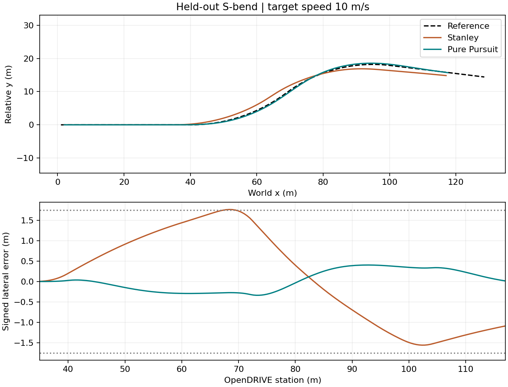
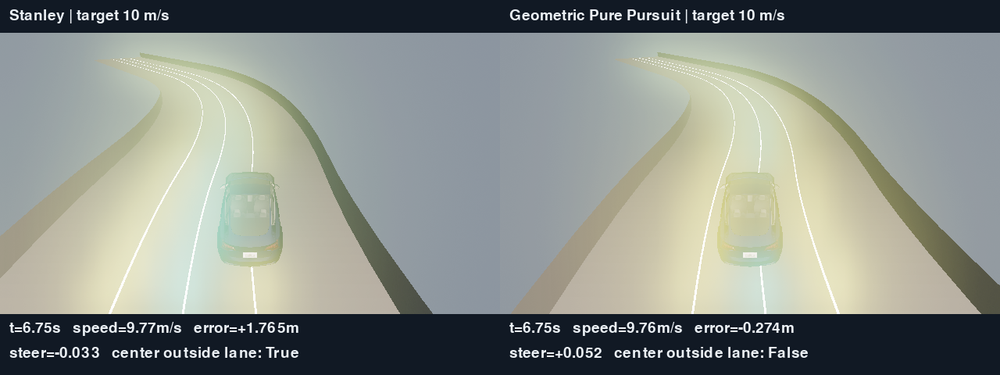

# CARLA 横向轨迹跟踪对照

在 CARLA 0.9.13 的物理车辆上，比较仓库中的 Stanley 和基于后轴几何的 Pure Pursuit。横向实验单独使用 CARLA。纵向 ACC 与 SUMO 背景交通的实验见[纵向评测](longitudinal.md)。



[观看 CARLA 双画面相机实录](lateral_comparison.mp4)。两次依次执行的仿真按仿真时刻对齐，左侧为原有 Stanley，右侧为几何 Pure Pursuit。青色线标记参考中心线，黄色线标记目标车道边界，均为调试叠加标记。6.75 s 时，车身中心偏差分别约 +1.765 m 和 −0.274 m。[相机运行汇总](lateral_camera_reference.json)



## 第一轮结果

表中数值依次为 Stanley / Pure Pursuit。速度是 PID 的目标值。两种控制器在留出 S 弯的评测区间平均车速均约 9.76 m/s。参数在留出测试前固定，第二轮使用相同工况从头运行。十对复跑指标中，横向 RMSE 最大差为 0.0015 m，中心越线次数均一致。

| 工况 | 速度 m/s | 横向 RMSE (m) | 绝对误差 P95 (m) | 中心越线次数 | 转向指令变化率 RMS (1/s) |
|---|---:|---:|---:|---:|---:|
| 直线 | 8 | 0.00 / 0.00 | 0.00 / 0.00 | 0 / 0 | <0.001 / <0.001 |
| 等曲率弯，参考线半径 65 m | 8 | 1.16 / 0.11 | 1.58 / 0.14 | 0 / 0 | 0.032 / 0.016 |
| S 弯，参考线半径 55 / 55 m | 8 | 0.77 / 0.14 | 1.32 / 0.20 | 0 / 0 | 0.054 / 0.034 |
| 留出反向圆弧，半径 52 m | 10 | 1.79 / 0.21 | 2.48 / 0.28 | 1 / 0 | 0.038 / 0.026 |
| 留出反向 S 弯，半径 50 / 42 m | 10 | 1.12 / 0.26 | 1.70 / 0.40 | 1 / 0 | 0.077 / 0.049 |

## 一次越线是怎样发生的

第一轮留出 S 弯中，Stanley 在 6.60 s 的归一化转向指令为 +0.0162，6.65 s 变为 −0.0012。此时车身中心距车道中心线 1.749 m。下一帧 6.70 s，误差增至 1.760 m，跨过 1.75 m 边界。6.75 s 达到 1.765 m，6.90 s 回到 1.732 m。在这段时间速度约 9.76 m/s。指令反向与轨迹回正之间存在延迟。相同配置下 Pure Pursuit 的最大偏差为 0.405 m。上述比较限于这台车、这套参数及这些弯道。

## 如何计算

- 自定义 OpenDRIVE 道路为平面，每条路由 40 m 直线、两段各 32 m 的指定曲率以及 30 m 出弯直线组成。用固定车道的地图 waypoint 每 0.5 m 采样中心线，投影到最近线段。误差取车辆原点至投影点的有符号平面距离。越线为绝对误差超过车道半宽 1.75 m，每段连续超限计一次。这项指标刻画车身中心，不衡量车轮压线。
- 在道路桩号 35–117 m 统计每帧误差的均方根、绝对值第 95 百分位以及每 50 ms 归一化转向指令差分的均方根。转向变化率的单位为每秒，不代表方向盘角速度。
- 同一 Tesla Model 3、速度 PID、起点、前视距离（3 m + 0.4 s × 当前速度）、归一化转向限幅 ±0.7 和一阶平滑系数 0.4。Stanley 沿用原控制器的转向输出与增益 0.3。Pure Pursuit 根据后轴到目标点的几何曲率、实测轴距和前轮最大转角计算指令。原山路演示使用目标方位角转向，本实验单独实现几何公式。
- 只接受已映射的参考路径和完整行程。缺失 waypoint 或未到达终点会中断该轮，没有自动驾驶回退。固定参数对照不代表两种算法各自最优的性能。

## 复现

在项目现有 Windows CARLA 0.9.13 环境中，启动空闲服务器。运行器临时生成 OpenDRIVE 地图，完成后重新加载起始地图。输出目录需为新目录。

```powershell
py -3.7 scenarios/run_lateral.py --output output/lateral-a
py -3.7 scenarios/run_lateral.py --output output/lateral-b
py -3.12 scenarios/report_lateral.py output/lateral-a output/lateral-b output/lateral.png
py -3.7 scenarios/record_lateral.py
```

报表只依赖 NumPy 和 Matplotlib。[下载此次两轮原始证据](lateral_traces.zip)，内含两个目录 lateral-final-a 与 lateral-final-b，分别保存地图、参考轨迹、逐帧 CSV 与全精度 JSON。解压后将这两个目录传给报表脚本，可离线重算指标并生成叠图。
