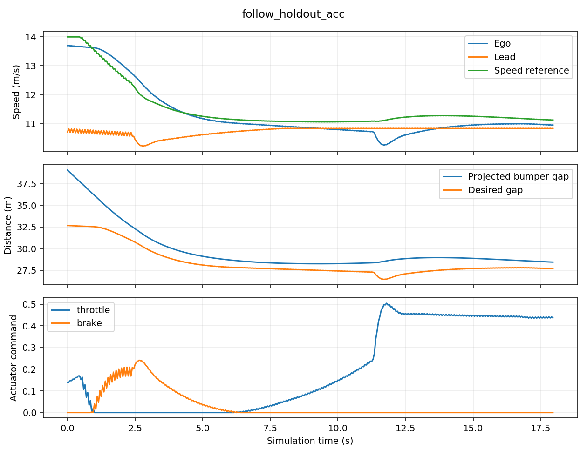

# CARLA-SUMO 纵向控制与场景评测

两种模式共用速度 PID、横向控制、AEB 和场景配置。定速基线把巡航速度直接交给 PID。ACC 根据车身纵向间距、相对速度与本车速度计算参考速度。前车状态来自 CARLA 仿真真值。SUMO 以 50 ms 步长提供背景交通。

## 复现

按 [主 README](../README.md) 启动空闲 Town04，并设置 CARLA 0.9.13、SUMO 1.18.0 和 Python 3.7 环境。运行期间由一个脚本推进仿真时钟。

```powershell
py -3.7 scenarios/run_longitudinal.py --case follow_holdout
py -3.7 scenarios/run_longitudinal.py --output output/longitudinal
py -3.7 scenarios/run_longitudinal.py --output output/longitudinal-repeat
py -3.7 scenarios/tune_longitudinal.py
py -3.12 scenarios/report_longitudinal.py --input output/longitudinal/summary.json --traces output/longitudinal --plots --output output/longitudinal-report
```

默认配置在 [longitudinal.json](../configs/longitudinal.json)，可以用 `--config` 指定副本。初始偏移是沿路的生成位置偏移，日志中的 `gap_m` 是沿自车航向投影的估计车身间距。稳定跟车、缓减速和急刹的目标车启用物理。切入和切出使用运动学轨迹。曲线报告需要在调用报告的 Python 环境安装 matplotlib。

调参只使用两个开发用例，对 3 × 3 个参数组合逐个比较。先看是否有碰撞、异常 AEB 介入、无效场景或间距不足 2 m，再比较稳态间距 RMSE 与 jerk。调参重跑会复用 `output/acc-tuning` 中完成的组合。改动控制逻辑或开发工况后先归档该目录。留出用例只用于验证。

ACC 使用目标间距 `8 m + 1.8 s × 自车速度`，由间距误差和闭合速度计算限幅后的加速度请求，再用一秒参考速度时域交给速度 PID。现有 AEB 用中心距离和 TTC 判定，固定距离保护可能让定速模式在常规跟车中过早停车。紧急制动锁定至本轮结束。

每轮保存配置、场景观测证据、碰撞事件和逐帧数据。存在场景未发生、车道偏离、背景交通缺失或非目标碰撞时，评测标为无效。正常跟车与缓减速的通过条件是无碰撞且 AEB 未介入。急刹和切入的通过条件还包括实际选择了目标，急刹必须触发 AEB。切出需先跟踪前车，前车离开后恢复巡航。邻道用例要求无 AEB 介入。运行异常和中断单独记录。

## 实测结果

9 个增益组合在开发工况中验证后，冻结间距增益 0.3、相对速度增益 0.4。10 个配置分别运行定速和 ACC，两轮各 20 次。两轮的有效性、碰撞判定、首次选中目标、首次 AEB 和首次接触时刻一致。[完整指标和调参记录](longitudinal_reference.json)

| 留出用例 | 定速基线 | ACC |
| --- | --- | --- |
| 稳定跟车 | 9.95 s 触发 AEB 并停车 | 无 AEB、无接触，稳态间距 RMSE 1.14 m |
| 前车缓减速 | 13.95 s 触发 AEB 并停车 | 无 AEB、无接触，稳态间距 RMSE 0.91 m |
| 前车切出 | 6.90 s 触发 AEB，未恢复巡航 | 7.35 s 确认切出，最终恢复到 11.75 m/s |
| 物理前车急刹 | 2.70 s 触发 AEB，最小投影间距 1.33 m | 未接触，最小间距 12.59 m。AEB 未介入，按该用例的介入判据记录为失败 |



[查看同工况双画面对照视频](acc_follow_holdout.mp4)。录制使用 CARLA 的实际 RGB 帧，展示定速模式介入制动后停车，以及 ACC 保持跟车。可在 CARLA 环境安装 `imageio-ffmpeg==0.5.1` 后运行 `py -3.7 scenarios/record_longitudinal.py` 重录。

两份可复现的失败记录都保留在参考数据中。

1. **6 m 偏移、12 m/s 自车初速**。用 `--case short_cutin_failure --mode acc` 复现。1.10 s 首次选择目标并请求 AEB，1.85 s 观察到横向进入，2.00 s 首次接触。接触前一帧自车约 31.12 km/h。早于接触制动仍不足以避免接触。
2. **12 m 偏移、14 m/s 自车初速**。用 `--case fast_cutin_failure --mode acc` 复现。1.10 s 选择目标并请求 AEB，2.00 s 接触，接触前一帧自车约 38.00 km/h。同为 12 m 偏移的 12 m/s 工况在观察窗口内无接触。

稳态误差只对无接触的跟车和缓减速工况计算。jerk 由未滤波车速差分，排除首秒及接触后的数据。ACC 在部分工况中波动更大，例如切出时 jerk RMS 约 100 m/s³，当前结果不支持普遍的舒适性提升。两种模式均使用同一 AEB，极端切入的失败也因此相近。

## OpenSCENARIO 1.0

[lead_slowdown.xosc](../scenarios/openscenario/lead_slowdown.xosc) 在空闲 Town04 使用 ScenarioRunner 的 NPC 控制器演示初速、速度动作和时间触发。它独立于 ACC 联合仿真实验。

```powershell
git clone --depth 1 --branch v0.9.13 https://github.com/carla-simulator/scenario_runner.git
$env:SCENARIO_RUNNER_ROOT = (Resolve-Path scenario_runner).Path
$env:PYTHONPATH += ";$env:CARLA_HOME\PythonAPI\carla"
py -3.7 -m pip install py-trees==0.8.3 networkx==2.2 Shapely==1.7.1 xmlschema==1.0.18 ephem==4.1.5 tabulate psutil==5.9.8 six simple-watchdog-timer
py -3.7 scenarios/run_openscenario.py --initial-speed 10 --trigger 4
py -3.7 scenarios/run_openscenario.py --initial-speed 12 --trigger 6 --output output/openscenario-variant
```

脚本保存 Runner 日志、仿真前车速度和观测结果。XML 的车辆实体定义改自 [ScenarioRunner v0.9.13 示例](https://github.com/carla-simulator/scenario_runner/blob/v0.9.13/srunner/examples/FollowLeadingVehicle.xosc)，按附带的 [MIT 许可](../scenarios/openscenario/LICENSE-ScenarioRunner)使用。

默认参数和变体均通过 Runner 的碰撞判据。实测速度分别达到约 10.19 和 12.16 m/s，随后均降至约 4 m/s。相对首次速度采样，降速阈值分别在约 4.5 和 6.6 s 越过。[两次运行证据](openscenario_reference.json)

## Linux 离线复核

在 Ubuntu 或 WSL 的仓库目录运行。使用 `--traces` 时会读取原始 CSV，重算指标并与汇总核对。可在没有 CARLA SDK 的 Python 环境执行。

```bash
python3 -m unittest discover -s tests -p test_longitudinal.py -v
python3 scenarios/report_longitudinal.py --input docs/longitudinal_reference.json --output output/reference-report
python3 scenarios/report_longitudinal.py --input output/longitudinal/summary.json --traces output/longitudinal --output output/replayed-report
```

## 独立练习

1. 从 12 m 切入的逐帧 CSV 找出首次制动，判断它是否早于首次接触。解释同样的切入偏移为什么会因初速改变而出现不同结果。
2. 复制 JSON 配置，把留出跟车工况前车速度降低 1 m/s。先写下对车距和制动的预测，再复跑并解释差异。
3. 不参考 AI 生成代码，实现或修正一个 ACC 小函数。用一个接近过快和一个等速跟车的输入手算结果，再运行测试。

这三项由项目使用者实际完成，记录时间、改动、结果和需要帮助的地方。
