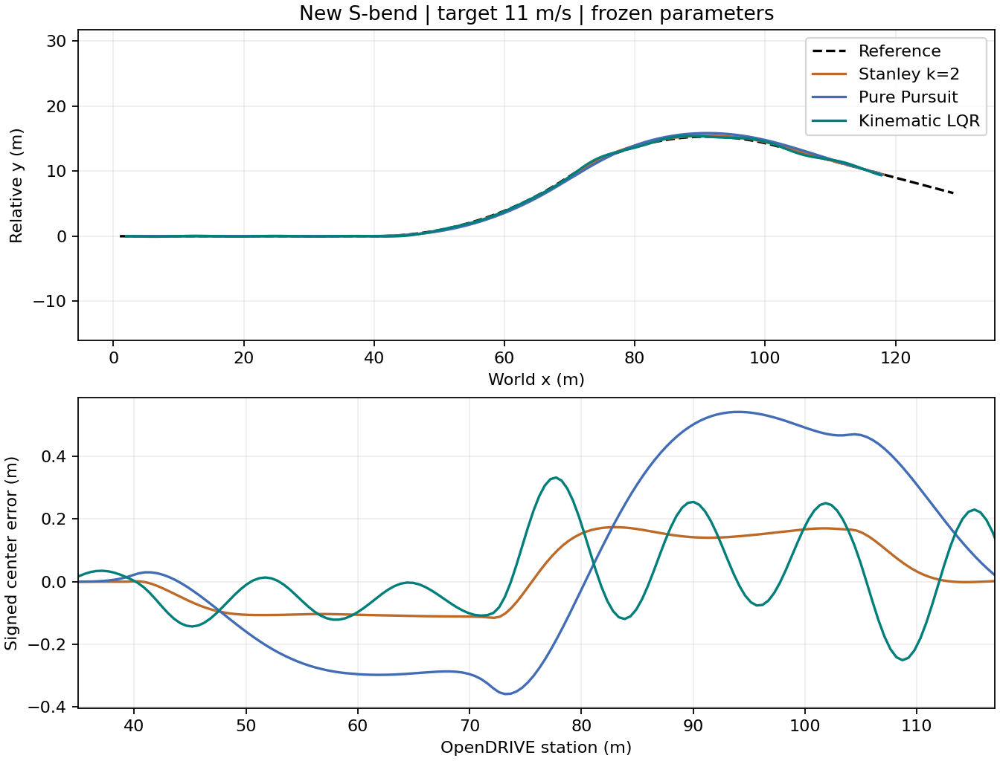

# LQR、Stanley 与 Pure Pursuit 的 CARLA 对照

[实际三画面视频](lqr_comparison.mp4) · [全精度结果](lqr_reference.json) · [相机运行结果](lqr_camera_reference.json) · [原始 CSV 与地图](lqr_traces.zip)



## 模型与控制

控制器使用后轴运动学自行车模型，状态为后轴到参考路径的横向偏差及车辆相对路径切向的航向偏差。CARLA 的平面坐标正 y 和正转向均指向右侧。以每个工况的目标速度 v 设计固定反馈增益，采样周期 dt=0.05 s，轴距 L 从仿真车辆轮心位置取得。

线性化误差模型的离散矩阵为 A=[[1,v*dt],[0,1]]，B=[[v²*dt²/(2L)],[v*dt/L]]。它使用零阶保持离散化，在小角度及低侧滑假设下成立。代价为各步 xᵀQx+uᵀRu 之和。用 NumPy 迭代离散代数 Riccati 方程，初始化时求出 K。每帧转角为 atan(L*曲率)−Kx，再除以前轮最大转角，进入与其他控制器共用的 ±0.7 限幅与 0.4 平滑。曲率由后轴最近参考线段附近约 2 m 的方向变化估计。设计模型未包含该平滑器和 CARLA 的速度相关转向曲线。

## 开发工况选参数

仅用三个开发工况（8 m/s 直线、65 m 参考线半径圆弧、55 m S 弯），比较 Q=diag(q,1)，R=1，q 取 0.05、0.2、1。先比较中心越线次数，再比较三工况 RMSE 之和，再比较转向变化率。三个候选均无中心越线。圆弧/S 弯 RMSE 分别约为 0.088/0.108 m、0.055/0.071 m、0.034/0.048 m。按既定顺序选 q=1 并冻结，随后执行新工况；该选择同时带来更大的转向波动。

## 冻结参数后的结果

三者使用同一 Tesla Model 3、纵向速度 PID、转向限幅、平滑和评价区间。跟踪误差统一按车身中心投影到地图参考线计算。控制器内部使用各自的前轴或后轴参考点。

| 工况 | 算法 | 横向 RMSE m | 绝对误差 P95 m | 中心越线 | 转向变化率 RMS /s | 计算时间 P95 μs |
|---|---|---:|---:|---:|---:|---:|
| 新圆弧，目标 7 m/s，参考线半径 70 m | Stanley k=2 | 0.005 | 0.007 | 0 | 0.026 | 94 |
| 同上 | Pure Pursuit | 0.090 | 0.117 | 0 | 0.014 | 32 |
| 同上 | LQR | 0.030 | 0.039 | 0 | 0.062 | 131 |
| 新 S 弯，目标 11 m/s，参考线半径 55/38 m | Stanley k=2 | 0.114 | 0.170 | 0 | 0.100 | 87 |
| 同上 | Pure Pursuit | 0.321 | 0.534 | 0 | 0.055 | 31 |
| 同上 | LQR | 0.137 | 0.253 | 0 | 0.515 | 130 |

两次新工况运行的六组中心越线次数全部一致，RMSE 最大重复差为 0.00016 m。既有 10 m/s S 弯中，三者 RMSE 约为 0.082、0.258、0.085 m，相机运行也保留了逐帧 CSV。

## 实际取舍及局限

LQR 在新 S 弯上比 Pure Pursuit 的偏差小，但其偏差和转向波动均高于修正后的 Stanley。7.10 s、桩号约 77.74 m 时，LQR 的车身中心偏差达到 0.333 m。6.75→6.80 s 的归一化指令由 −0.053 变为 −0.112，之后的误差曲线持续振荡。这是可复现的性能不足。曲率拼接、简化运动学模型与执行器平滑之间的影响仍需另做实验区分。

计算时间记录控制分支内的路径处理、反馈运算及共用转向限幅/平滑，排除车辆状态读取、公共中心线投影、渲染、仿真推进与纵向 PID。LQR 初始化 Riccati 求解耗时另存 setup_us，在本次新工况约 1.9–3.4 ms。单机计时会受调度影响，不代表端到端延迟。

全部结果来自平面仿真道路和真值状态。初始速度通过 CARLA 设置，之后由物理车辆和 PID 演化。没有传感器噪声、低附着或延迟验证。控制器间的结果只适用于当前参数与工况。

## 复现

沿用项目的 CARLA 0.9.13 Windows Python 3.7 环境。纯 Python 算法与离线报告依赖 NumPy，绘图另需 Matplotlib。输出目录需为新目录，服务器需空闲。

```powershell
py -3.7 scenarios/run_lateral.py --suite development --modes lqr --lqr-weight 0.05 --output output/lqr-q005
py -3.7 scenarios/run_lateral.py --suite development --modes lqr --lqr-weight 0.2 --output output/lqr-q02
py -3.7 scenarios/run_lateral.py --suite development --modes lqr --lqr-weight 1 --output output/lqr-q1
py -3.7 scenarios/run_lateral.py --modes stanley_fixed pursuit lqr --output output/lqr-known
py -3.7 scenarios/run_lateral.py --suite lqr_validation --modes stanley_fixed pursuit lqr --output output/lqr-new
py -3.7 scenarios/run_lateral.py --suite lqr_validation --modes stanley_fixed pursuit lqr --output output/lqr-new-repeat
py -3.12 scenarios/report_lqr.py
py -3.7 scenarios/record_lateral.py --lqr --output output/lqr-camera
py -3.12 -m unittest discover -s tests -p test_lqr_tracking.py
```

原始压缩包的六个目录解压到 output 后，可独立运行 report_lqr.py 复算空间误差、转向变化率、计时分位数及重复运行差异。测试覆盖 Riccati 方程残差、闭环矩阵稳定性、反馈方向、曲率前馈、航向包角和权重输入。
