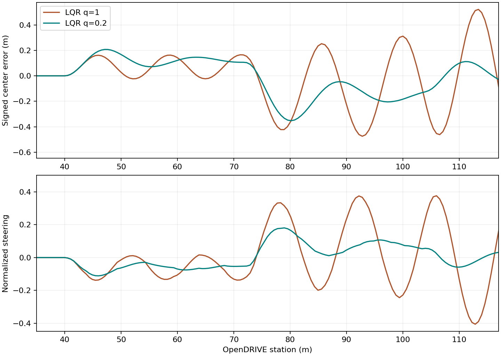
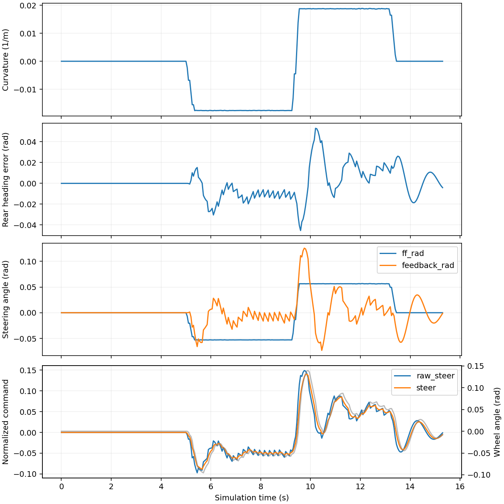

# LQR 振荡诊断、参数冻结与偏移恢复

[实际双画面视频](lqr_refinement.mp4) · [全精度结果](refinement_reference.json) · [原始证据](refinement_traces.zip) · [相机运行结果](refinement_camera.json)



## 两个工程问题

逐帧增加了后轴横向误差、航向误差、路径曲率、前馈转角、反馈转角、限幅前指令、最终指令和实际左前轮转角。

起点位于桩号 2 m，旧参考线从 1 m 开始，后轴位于第一个参考点后方。折线端点的最近距离含有沿路分量，会被当成横向误差。诊断记录中，无初始偏移的首帧后轴误差约 0.386 m，导致不应有的转向。参考线现从 0 m 开始，起点位置维持桩号 2 m。车辆轮心世界坐标通过当前逆变换转为车身坐标，以支持初始航向偏差。离线复核要求无扰动开发工况首帧后轴误差及转向请求均小于 0.001。

原参数的 12 m/s、初始偏移 0.5 m 用例，两次先前的控制/推进分开发送分别出现 4 次和 3 次中心越线。两次日志在 5.30 s 之前几乎一致，5.35 s 的车轮转角分别约 0.008 rad 和 0.127 rad，伴随轨迹开始分离。改为 apply_batch_sync 同时提交控制与推进后，两次均复现 3 次中心越线。原始异步记录另保存在压缩包的 recover-offset-async 与 recover-offset-repeat-async。可用 --async-control 对照旧提交方式，具体计数仍可能变化。

## 单项对照及参数选择

起点修正后，所有正式对照采用同步批处理。固定开发工况为 8 m/s 直线、参考线半径 65 m 圆弧及 55 m S 弯。R=1，航向误差权重为 1，只改变指定因素。

| 单项改动 | S 弯 RMSE 约 m | S 弯指令变化率 RMS 约 /s | 观察 |
|---|---:|---:|---|
| 基线 q=1、平滑系数 0.4 | 0.048 | 0.147 | 基准 |
| 关闭曲率前馈 | 0.102 | 0.157 | 误差及波动增加 |
| 平滑系数改为 1 | 0.042 | 0.181 | 误差下降，波动增加 |
| 横向误差权重 q=0.2 | 0.071 | 0.103 | 波动下降，误差增加 |
| 横向误差权重 q=0.05 | 0.108 | 0.087 | 波动更小，误差进一步增加 |

因此，关闭前馈与取消平滑均未解决本轮精度及波动的取舍。本轮自行设定开发工况 RMSE 上限 0.10 m、中心越线为 0，在满足约束的候选中选择转向变化率总和最低的一组，冻结 q=0.2。该阈值为本项目的开发选择，未引用行业合格标准。新增 lqr_smooth 模式使用固定权重 0.2，原 lqr 模式保留默认 q=1。



图中归一化指令与实际车轮转角使用独立纵轴。实际轮角用于定位响应时序，本轮未辨识完整物理转向模型，不能单凭这些记录断言车辆执行器的固定延迟。

## 新工况与恢复

冻结参数后，新增 9 m/s、参考线半径 75 m 圆弧和 12 m/s、48/42 m S 弯，分别从中心、横向偏移 +0.5 m、航向偏差 +3° 开始。每组含 Stanley k=2、Pure Pursuit、LQR q=1 和 LQR q=0.2，均重复两次。

中心起步的新 S 弯中，LQR q=1 / q=0.2 的横向 RMSE 约为 0.224 / 0.145 m，指令变化率 RMS 约为 0.917 / 0.212 /s，两者均无中心越线。同期 Stanley 约 0.145 m、0.114 /s，Pure Pursuit 约 0.345 m、0.065 /s。新参数降低了原 LQR 的振荡，但转向波动仍高于两个对照控制器。

恢复时间从首个控制样本开始计算，要求车身中心偏差不超过 0.10 m、航向偏差不超过 2°，连续满足 20 个样本，记录该段的起点。只在桩号 35 m 之前的直线观察，未出现完整稳定窗口记为“未观测到”。它不代表之后永远不能恢复。

| 12 m/s 工况 | Stanley | Pure Pursuit | LQR q=1 | LQR q=0.2 |
|---|---:|---:|---:|---:|
| 横向偏移 +0.5 m，恢复时间 s | 0.75 | 1.15 | 未观测到 | 1.45 |
| 航向偏差 +3°，恢复时间 s | 0.90 | 1.25 | 未观测到 | 0.75 |
| 偏移用例全段中心越线次数 | 0 | 0 | 3 | 0 |

偏移用例中四者初始中心偏差均为 0.50 m，直线段最大绝对偏差也是 0.50 m。航向用例直线最大偏差约为 0.120、0.197、0.100、0.112 m。它们分别记录于 recovery_peak_m，曲线段最大偏差仍由 peak_m 单独统计。

同步推进后三组复跑的中心越线及恢复观察结果一致，恢复时刻差不超过一步 50 ms，各组最大 RMSE 重复差约 0、0.00053、0 m。空间误差、指令变化率、输入偏差、恢复窗口与平滑输出均已从 CSV 离线重算。

## 复现

沿用 [LQR 环境](lqr.md)。服务器需空闲，输出目录需为新目录。原始压缩包含所需 output 子目录，解压后可直接运行离线报告，保留了先前两次不一致记录。

```powershell
py -3.7 scenarios/run_lateral.py --suite development --modes lqr --output output/diag-base
py -3.7 scenarios/run_lateral.py --suite development --modes lqr --ff-scale 0 --output output/diag-noff
py -3.7 scenarios/run_lateral.py --suite development --modes lqr --steer-alpha 1 --output output/diag-nofilter
py -3.7 scenarios/run_lateral.py --suite development --modes lqr --lqr-weight 0.2 --output output/diag-q02
py -3.7 scenarios/run_lateral.py --suite development --modes lqr --lqr-weight 0.05 --output output/diag-q005
py -3.7 scenarios/run_lateral.py --suite refinement_validation --modes stanley_fixed pursuit lqr lqr_smooth --output output/refine-new
py -3.7 scenarios/run_lateral.py --suite refinement_validation --modes stanley_fixed pursuit lqr lqr_smooth --output output/refine-new-repeat
py -3.7 scenarios/run_lateral.py --suite refinement_validation --modes stanley_fixed pursuit lqr lqr_smooth --initial-offset 0.5 --output output/recover-offset
py -3.7 scenarios/run_lateral.py --suite refinement_validation --modes stanley_fixed pursuit lqr lqr_smooth --initial-offset 0.5 --output output/recover-offset-repeat
py -3.7 scenarios/run_lateral.py --suite refinement_validation --modes stanley_fixed pursuit lqr lqr_smooth --initial-yaw 3 --output output/recover-heading
py -3.7 scenarios/run_lateral.py --suite refinement_validation --modes stanley_fixed pursuit lqr lqr_smooth --initial-yaw 3 --output output/recover-heading-repeat
py -3.12 scenarios/report_refinement.py
py -3.7 scenarios/record_lateral.py --refined --output output/refine-camera
```

视频为两次依次执行的 CARLA 相机运行，按仿真时间对齐。曲率、路面及车辆仍采用理想仿真设定，结论限于当前速度、偏移和弯道。
