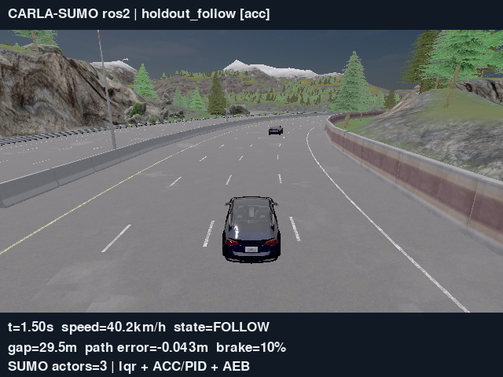
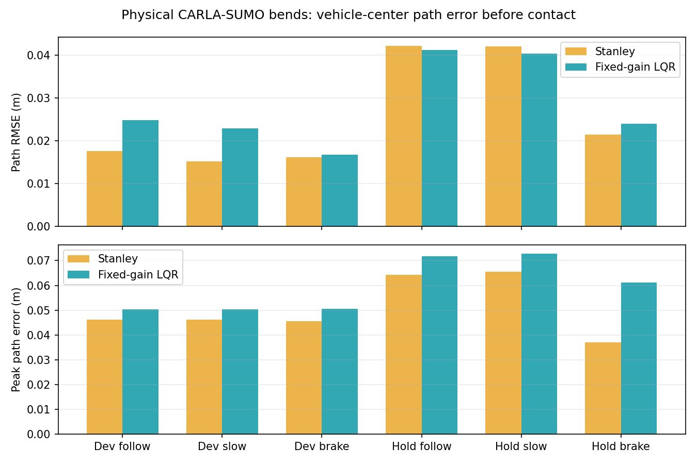
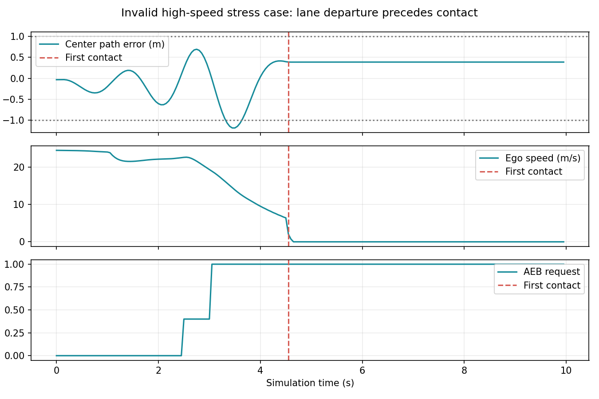

# Eigen LQR 的 C++ / ROS 2 运行时验证

[48 秒实跑视频](lqr_runtime_demo.mp4) · [完整结果](lqr_runtime_reference.json) · [CSV 与 rosbag2](lqr_runtime_traces.zip)



将已有 Python 后轴运动学 LQR 等价移植到 Eigen / C++17，再接入现有 CARLA-SUMO 和 ROS 2 Jazzy 控制链路。本阶段保持原模型、代价权重、固定设计车速及转向限幅，检验实现和部署是否一致。随车速调整增益是后续独立实验，本阶段没有实现或宣称这项能力。

## 模型、实现与接口

状态为后轴横向误差和航向误差，控制输入为转角。离散模型沿用：

```text
A = [[1, v*dt], [0, 1]]
B = [[v²*dt²/(2L)], [v*dt/L]]
Q = diag(0.2, 1), R = 1
delta = atan(L*curvature) - K*[lateral_error, wrapped_heading_error]
```

设计速度 v 在每次用例创建时固定；实际车辆速度仍随 ACC 和制动变化。开发弯道设计速度 9 m/s，留出 12 m/s，高速压力 25 m/s。车辆轴距从 CARLA 物理轮位提取，录像留出车约为 3.00463 m，没有把合成单元测试的 2.9 m 轴距当成实车参数。

Eigen 以 2×2 固定矩阵迭代求解离散 Riccati 方程，最大 10,000 次，迭代差阈值 1e−10。每例只在创建控制器时求解一次。反馈采用航向角归一化；转角转换为归一化控制后，继续使用 ±0.7 限幅和系数 0.4 的一阶低通。ACC、速度 PID 和 AEB 仲裁继续共用原核心。会话重置保留 LQR 增益，清空 PID、滤波和 AEB 锁定状态。

C 接口保留原 ControlConfig / ControlInput 布局，新增 control_create_lqr、control_step_lqr 和供诊断使用的 control_lqr_solution。Python ctypes 与 ROS 节点均调用这些接口。修改源码后需要重新编译共享库。

ROS 新增 LqrState，嵌套原 ControlState，附加曲率、设计车速、轴距、设计步长和位置权重，通过 /control/lqr_state 发送；输出继续是 /control/command。原 /control/state 消息及命令消息保持原结构。两个输入主题共用一个节点和会话/帧序号检查，每次只处理一个前端控制请求。

Windows 检出时曾将脚本换行转成 CRLF，导致 WSL 无法执行 python3 shebang；已为 ROS 可执行 Python 脚本设置 .gitattributes 的 LF 规则。

## 数值及状态验证

15 组速度与权重组合覆盖设计车速 0.5、4、8、12、25 m/s，以及位置权重 0.05、0.2、1：

| 检查 | 本机最大观测值 |
|---|---:|
| Eigen / NumPy 增益绝对差 | 4.44e−16 |
| Riccati 矩阵绝对差 | 5.68e−14 |
| 原方程残差最大元素 | 9.85e−11 |
| 闭环模型最大谱半径 | 0.99349 |

闭环谱半径检查针对理想离散线性模型，不能证明带车辆动力学、限幅和滤波的实际系统全域稳定。

另做 2,000 帧随机连续输入对照，包括变化的实测速度、正负曲率、航向跨 ±π、目标消失、限幅、AEB 锁定和控制器重置；全部输出差在 1e−9 内。无效参数、Riccati 不收敛和 NaN 曲率有明确拒绝，拒绝帧不推进控制状态。

Windows / Ubuntu 均通过 44 项相关离线测试及原 CTest；5 项实际 ROS 集成测试覆盖旧 Stanley 链路及新增 LQR 链路，包括 600 帧 LQR 消息对照和无效曲率、重复帧检查。

## 闭环等价性

冻结同一车型、路径、纵向控制和场景参数，运行：

- 10 例直路 ACC，包含跟车、减速、急刹、切入、切出与邻道。
- 7 例物理前车弯道 ACC，包含开发、留出及高速场景。
- 1 例高速定速加 AEB 压力工况。

Python LQR 跑一轮；C++ DLL 和 ROS 2 各重复两轮，共 90 次、21,200 帧。Python 直路功能判定也与原 integrated_reference.json 中的 LQR 数据对齐。

| 组别 | DLL 最大逐帧指令差 | ROS 最大逐帧指令差 |
|---|---:|---:|
| 直路 | 1.11e−16 | 1.11e−16 |
| 弯道 ACC | 2.78e−17 | 3.47e−17 |
| 高速定速加 AEB | 8.33e−17 | 8.33e−17 |

指令比较覆盖参考车速、油门、制动、转向及锁定制动。每帧实际下发所选后端输出，原 Python 计算用于旁路比较。三种实现的有效性、功能判定、是否碰撞、错误目标 AEB、巡航恢复和关键事件均通过既有对照；事件容差为 50 ms。重复运行检查单独保存。失败用例没有被移植验证改成通过。

录像逐帧 CSV 额外保存控制所用后轴误差、参考航向、曲率、最大转角、闭合速度及目标状态，JSON 保存实际 LQR 模型参数。离线重建 Python 和 C++ 控制器，960 帧指令均可由 CSV 复算，最大误差约为 1.39e−16。

## 常规弯道与高速边界

下表沿用原项目指标，衡量车身中心到路线的接触前误差；LQR 控制反馈自身使用后轴误差，两者有明确区分。

| 场景 | 中心误差 RMSE m | 最大中心偏差 m | 判定 |
|---|---:|---:|---|
| 开发跟车 | 0.0248 | 0.0504 | 通过 |
| 开发缓减速 | 0.0229 | 0.0504 | 通过 |
| 开发急刹 | 0.0167 | 0.0506 | 通过 |
| 留出跟车 | 0.0413 | 0.0718 | 通过 |
| 留出缓减速 | 0.0404 | 0.0728 | 通过 |
| 留出急刹 | 0.0240 | 0.0612 | 通过 |
| 高速 ACC | 0.1093 | 0.3523 | 通过 |



常规弯道 LQR 均无接触，但多项峰值偏差高于原 Stanley。这里比较的是两套已冻结的控制器及其原有误差参考点，没有重新为留出工况调参。这些结果不支持“LQR 普遍优于 Stanley”的结论。

高速定速加 AEB 用例则在 2.50 s 首次部分制动，3.05 s 全力制动，3.35 s 中心路径偏差首次超过 1 m，4.55 s 接触。接触前最大偏差约 1.187 m。现有工程有效性规则因此标记 ego_left_reference_lane，结果是 invalid。1 m 是项目规则，不是法规车道线判据。不能用这一无效工况的接触速度或时刻声称 AEB 安全性能改善。



本轮定位到越界先于接触，尚未通过消融实验把问题归因于固定设计车速、曲率、模型或滤波中的某一个因素。视频最后一段保留这个案例。

## 录包回放与兼容性

新 LQR 录包覆盖四段录像：960 帧输入、960 帧命令。使用独立 ROS domain 54 启动全新 C++ 节点，通过实际 ros2 bag play 以 0.5 倍墙钟速度回放输入，排除已录制的命令主题。960 帧重新生成命令全部匹配，最大差为 0。

更新后的节点还回放了上一版 360 帧 Stanley 录包，命令最大差为 0。旧消息结构和旧录包兼容性经过实际验证。

## 构建与复现

从仓库根目录运行。Eigen 按 [官方 CMake 接入方式](https://libeigen.gitlab.io/eigen/docs-3.4/TopicCMakeGuide.html) 使用 Eigen3::Eigen。Windows 本次使用官方 3.4.0 源码包，校验 SHA256 后安装头文件与 CMake 配置：

```powershell
New-Item -ItemType Directory -Force output/deps | Out-Null
curl.exe --fail --location https://gitlab.com/libeigen/eigen/-/archive/3.4.0/eigen-3.4.0.tar.gz -o output/deps/eigen.tar.gz
(Get-FileHash output/deps/eigen.tar.gz -Algorithm SHA256).Hash
# 预期：8586084F71F9BDE545EE7FA6D00288B264A2B7AC3607B974E54D13E7162C1C72
tar -xzf output/deps/eigen.tar.gz -C output/deps
cmake -S output/deps/eigen-3.4.0 -B output/deps/eigen-build -DBUILD_TESTING=OFF -DCMAKE_INSTALL_PREFIX="$PWD/output/deps/eigen-install"
cmake --install output/deps/eigen-build
cmake -S native -B output/native-win -A x64 -DCMAKE_PREFIX_PATH="$PWD/output/deps/eigen-install"
cmake --build output/native-win --config Release
py -3.12 -m pip install numpy
py -3.12 -m unittest discover -s tests -p test_lqr_native.py -v
```

Ubuntu / WSL 安装 libeigen3-dev 和 python3-numpy 后按原流程构建：

```bash
sudo apt-get install -y libeigen3-dev python3-numpy
cmake -S native -B output/native-linux -G Ninja -DCMAKE_BUILD_TYPE=Debug
cmake --build output/native-linux
python3 -m unittest discover -s tests -p test_lqr_native.py -v
source /opt/ros/jazzy/setup.bash
colcon --log-base output/ros-log build --base-paths ros2 --build-base output/ros-build --install-base output/ros-install
source output/ros-install/setup.bash
ROS_DOMAIN_ID=53 ros2 launch control_runtime control.launch.py
```

保持原 CARLA 0.9.13 / SUMO 1.18.0 环境及空闲 Town04，Windows 可分别执行：

```powershell
$env:ROS_LIVE_TEST='1'
py -3.12 -m unittest discover -s tests -p test_ros_live.py -v
py -3.7 scenarios/run_longitudinal.py --lateral lqr --backend cpp --config configs/curved.json --mode acc --output output/lqr-cpp-new
py -3.7 scenarios/run_longitudinal.py --lateral lqr --backend ros2 --config configs/curved.json --mode acc --output output/lqr-ros-new
py -3.7 scenarios/record_integrated.py --lateral lqr --backend ros2 --preview --config configs/curved.json --output output/lqr-video-new
```

录包需包含 /control/lqr_state，而非只录原 /control/state；其他主题和停止刷盘方式沿用原运行时文档。

无仿真环境时可从压缩包复算 90 次日志的指标：

```bash
python3 -m zipfile -e docs/lqr_runtime_traces.zip output/lqr-from-zip
python3 scenarios/report_lqr_runtime.py --input output/lqr-from-zip --output output/lqr-from-zip-audit.json

# 已构建 ROS 包并 source 环境后，重新生成录包命令
ROS_DOMAIN_ID=54 python3 ros2/control_runtime/scripts/verify_bag.py --bag output/lqr-from-zip/bag --output output/lqr-replay-new.json
```

GitHub Actions 增加 Eigen 依赖、原生 LQR 测试和 ROS LQR 测试，Windows 下载包检查同一 SHA256。个人练习仍需本人完成：推导 A/B 中的速度项，说明为何重置不能清除增益或保留旧积分，再从高速失败 CSV 定位 3.35 s 的越界证据。工程与测试由 AI 辅助完成，尚未验收个人独立掌握程度。
