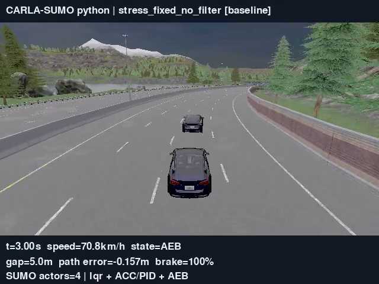
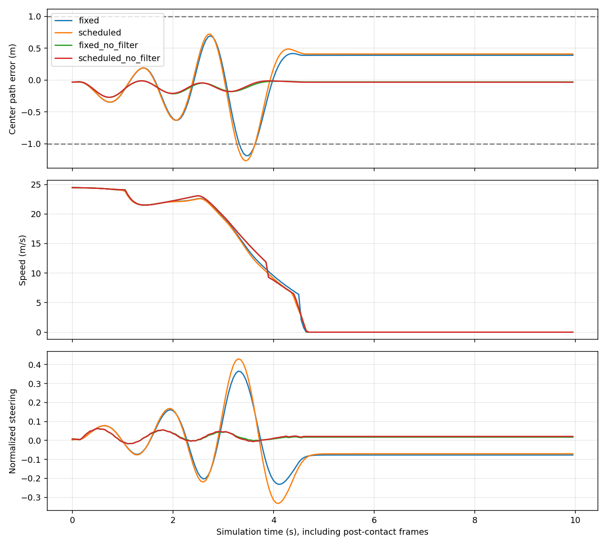

# 高速 LQR：车速增益与转向滤波对照

[完整结果](lqr_speed_reference.json) · [逐帧 CSV](lqr_speed_traces.zip) · [实际摄像头录像](lqr_speed_demo.mp4)



本轮从已有高速越界失败出发，检验“固定设计车速是否导致偏离”。结论是：**在该工况下，单独调度增益没有解决越界；移除原转向滤波明显减小偏差，但仍追尾。** 默认固定增益、滤波系数 0.4、原 C++/ROS 2 路径均保留。

## 固定条件与实验变量

CARLA 0.9.13 / SUMO 1.18.0，Town04，Tesla Model 3，物理前车，仿真真值目标状态，固定 50 ms 步长、seed 42。同一参考路线、轴距、纵向 PID、ACC/AEB 策略及 ±0.7 归一化转向限幅。每个配置重复两次。

固定 LQR 按初始车速计算一次 K；调度版本在 1–30 m/s 的整数速度网格上预计算同一 Q/R 的 K，按实际速度线性插值，范围外钳位到端点。低于 1 m/s 的行为只是本轮实验约定，不代表停车控制设计。模型、权重与原实现相同。理想离散模型的谱半径测试不构成实际车辆稳定性证明。

滤波为 `u[t] = alpha * clip(raw, -0.7, 0.7) + (1-alpha) * u[t-1]`。alpha=0.4 是原值，alpha=1 表示移除滤波。这里只检验两个端点，没有搜索最优 alpha。调度和滤波消融仅在 Python 后端开放，C++/ROS 请求这些实验参数会被明确拒绝，避免以旧后端输出冒充新算法。

## 压力用例：2×2 消融

自车 25 m/s、前车 20 m/s、初始偏移 30 m、1 s 前车急刹，自车采用定速 PID+AEB，观测 10 s。该历史留出用例已经用于定位问题，**本轮属于诊断数据**。

| 增益 | alpha | 接触前中心偏差峰值 m | 首次超过 1 m / s | 首次接触 / s | 判定 |
|---|---:|---:|---:|---:|---|
| 固定 | 0.4 | 1.1872 | 3.35 | 4.55 | invalid |
| 调度 | 0.4 | 1.2701 | 3.30 | 未接触 | invalid |
| 固定 | 1.0 | 0.2723 | 未超过 | 3.90 | fail |
| 调度 | 1.0 | 0.2705 | 未超过 | 3.90 | fail |

原固定版本精确复现历史峰值与关键时刻。调度版本虽未接触，但已偏离参考区域，不能将它表述为安全改善。移除滤波后路径条件恢复有效，暴露了有效输入下的 AEB 追尾失败；更早接触也不等于 AEB 本身变差，因为车辆实际运动轨迹已经改变。

这组实验支持“该配置对转向滤波敏感”，不证明滤波是所有高速失效的唯一原因。转向滤波、车辆动力学和离散控制的相互作用还需在更多路线、速度及附着条件上验证。



图中保留完整观察窗口，包含接触后帧；表内 RMSE、峰值、P95、转向变化率均仅使用首次接触前帧，不能将接触后曲线当作正常跟踪性能。

## 常规验证与复算

使用冻结的四种配置复跑原 7 个弯道 ACC 工况，各重复两次，另加上述 8 次压力诊断。沿用历史 development/holdout 标签，没有为这些工况重新调参；它们也不是本轮从未看过的新测试集。

64 次运行均完成；56 次常规 ACC 均通过，32 对重复运行的判定一致，四类关键事件时刻差均为 0。以下为接触前中心偏差峰值（m），两轮相同：

| ACC 工况 | 固定 / 0.4 | 调度 / 0.4 | 固定 / 1.0 | 调度 / 1.0 |
|---|---:|---:|---:|---:|
| 开发跟车 | 0.0504 | 0.0504 | 0.0396 | 0.0396 |
| 开发缓减速 | 0.0504 | 0.0504 | 0.0396 | 0.0396 |
| 开发急刹 | 0.0506 | 0.0504 | 0.0402 | 0.0401 |
| 历史留出跟车 | 0.0718 | 0.0716 | 0.0570 | 0.0567 |
| 历史留出缓减速 | 0.0728 | 0.0727 | 0.0582 | 0.0581 |
| 历史留出急刹 | 0.0612 | 0.0602 | 0.0505 | 0.0496 |
| 高速 ACC | 0.3523 | 0.3603 | 0.2455 | 0.2417 |

这些结果没有覆盖新车型、附着变化或新的道路几何，故仍将移除滤波作为实验选项，暂不替换默认控制链路。完整 JSON 另含 RMSE、P95、转向变化率、功能指标和原始配置。

P95 取中心偏差绝对值的 nearest-rank 分位数；转向变化率为相邻归一化指令差除以 0.05 s，单位 1/s，不是实测车轮转角速度。误差指标衡量车身中心，控制反馈仍使用后轴误差。1 m 是本项目有效性规则，不是法规车道线判据。

离线报告从 CSV 重新计算原功能指标和新增指标，检查每对重复运行的碰撞、有效性及功能判定一致，关键事件时刻相差不超过一个步长。Linux 和 Windows 验证调度网格、插值、端点钳位、理想模型稳定性和后端拒绝条件。CI 从仓库压缩包执行同样复算，不连接仿真器。

本机通过 41 项相关 Windows 离线测试、6 项 Ubuntu 调度相关测试及原 9 组实际 AEB 回归。30 秒 RGB 录像为 600 帧 / 20 fps，包含固定、调度、固定且移除滤波三个压力片段；三段关键指标均与无摄像头诊断相同。[录像逐段结果](lqr_speed_camera_reference.json) 保留实际参数与判定。预览窗口按 20 fps 限速，确保画面可观察；仿真仍以 50 ms 同步推进。

## 复现

在 README 的 CARLA/SUMO 环境上运行，确保空闲、异步、无车辆的 Town04；Python 3.7 还需可导入 `lxml` 和 `simple_pid`。本机补装位置为 `D:\AIData\Python37Packages`，将其加入 PYTHONPATH；下载、临时文件及所有下列输出均放在 D 盘仓库。

```powershell
py -3.7 scenarios/run_lqr_speed.py --output output/speed-diagnosis
py -3.7 scenarios/run_lqr_speed.py --phase validation --output output/speed-validation
py -3.7 scenarios/run_lqr_speed.py --phase validation --filter-alpha 1 --output output/speed-filter-validation
py -3.12 scenarios/report_lqr_speed.py --diagnosis output/speed-diagnosis --validation output/speed-validation --filter-validation output/speed-filter-validation --output output/speed-report --plots
```

每个仿真输出目录必须新建，避免旧结果混入。无仿真器时，解压逐帧 ZIP 到 output/speed-replay，再将三个输入目录分别替换为其中的 diagnosis、validation、filter_validation，即可复算。绘图需要 matplotlib；不加 --plots 只进行数值审核和归档。

下一步应针对有效的追尾失败复核目标选择、AEB 触发、剩余间距与减速度，而不是用越界躲开接触。以上开发由 AI 辅助完成，个人独立解释能力仍需另行验收。
