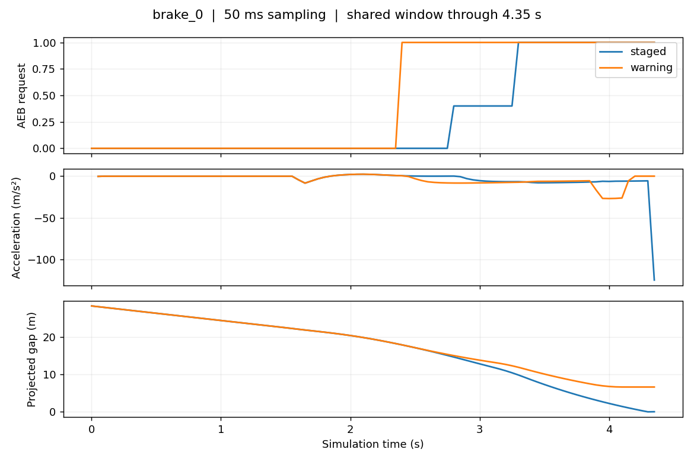

# 从一次批跑中断到可复查的场景结论

[90 秒演示](verification_demo.mp4) · [配置与三轮原始日志](recovery_traces.zip) · [逐例事件对照](recovery_reference.json) · [KITTI 消融](../experiments/kitti_tracking/README.md)

## 批跑中断与恢复

在空闲 Town04 按主 README 设置 CARLA 0.9.13、SUMO 1.18.0 和 Python 3.7。下列命令复现跟车、急刹和切入的完整批次、中断恢复以及损坏副本测试。输出目录必须为新目录。

```powershell
python tools/verify_batch_recovery.py output/recovery-new
python -m unittest discover -s tests -p test_batch_resume.py -v
```

日常批跑可用 `python scenarios/run_longitudinal.py --mode acc --resume --output output/study`。中断后使用相同命令。每个用例完成后原子更新汇总，恢复时检查配置、控制参数、后端、源代码身份及逐帧文件 SHA256。识别到运行中断、执行错误或文件损坏时，在输出目录归档上一次尝试，重跑对应工况。旧版汇总缺少身份信息时使用新目录。故障注入发生在第二个用例已登记、尚未推进物理仿真时。强制终止仿真进程可能留下车辆或同步时钟，需要先恢复空闲 Town04。

| 同一批 ACC 工况 | 判定 | 首次选中 / s | 首次 AEB / s | 首次接触 / s |
|---|---|---:|---:|---:|
| 稳定跟车 | 通过 | 0.00 | — | — |
| 前车急刹 | 功能未通过，未出现预期 AEB | 0.00 | — | — |
| 6 m 切入 | 功能未通过，接触 | 1.10 | 1.10 | 2.00 |

完整运行和恢复运行的四个事件时刻（目标、场景、AEB、接触）逐项相同。恢复时跟车日志 SHA256 保持一致。损坏切入 CSV 的副本后单独重跑该工况，随后重复恢复两次，三个 CSV 的哈希均保持一致。碰撞传感器可连续回调，表中按工况与首次接触统计。

## 一次制动已经介入的切入碰撞

解压日志，打开 `full/short_cutin_failure_acc.csv` 与同目录汇总。自车设定 12 m/s，运动学目标 8 m/s，初始沿路偏移 6 m。1.05 s 自车仍在巡航，1.10 s 首次选中目标并请求全制动，此刻横向间隙尚有 1.25 m，沿行驶方向的车身投影间距已为 −3.46 m。1.85 s 横向间隙转负，2.00 s 传感器记录首次接触，接触前一帧车速 31.12 km/h。

逐帧数据支持“已识别且已制动，邻车仍继续横移”。负纵向投影表示车身沿纵向已有重叠，不能单独判定碰撞。要判明更早识别能否避免接触，需要保持相同轨迹并单独改变触发策略。当前记录也无法代替真实驾驶员对切入车辆的响应。

## brake_0 的安全性与舒适性



冻结集 brake_0 两种策略从 0 s 就选中同一工况的前车。分级策略首次 AEB 为 2.80 s，提前全力策略为 2.40 s。原策略 4.35 s 首次接触，提前全力策略在观察期内无接触。图中共同显示区间内最小沿向投影间距分别为 −0.08 m（4.30 s）和 6.55 m（4.35 s）。速度以 50 ms 作一阶差分得到加速度，再差分得到 jerk。共同窗口 jerk RMS 由 19.95 升至 67.27 m/s³，提前全力策略有约 26.94 m/s² 单帧差分减速度尖峰。该数值受离散采样和仿真物理影响。[冻结配置](../configs/independent_aeb.json) · [16 组结果及共同窗口计算方法](independent_aeb.md)

