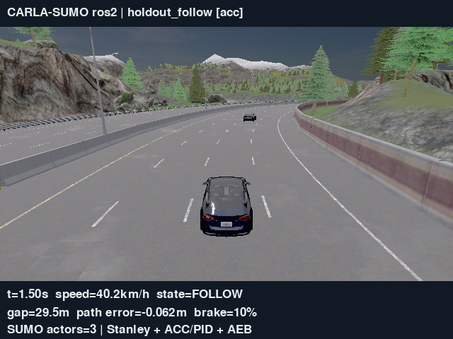
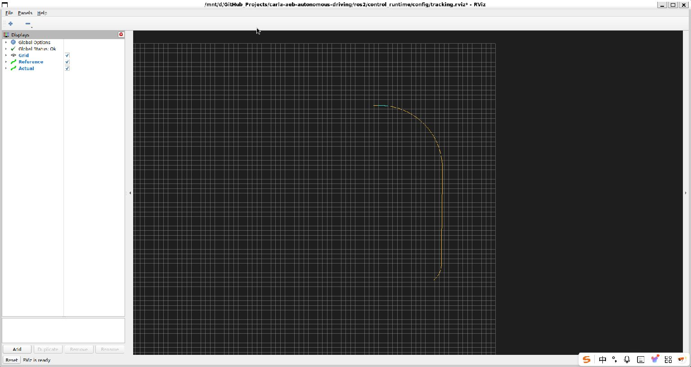

# C++17 与 ROS 2 控制运行时验证

[四场景实际相机录像（48 秒）](runtime_demo.mp4) · [完整实测结果](runtime_reference.json) · [原始 CSV 与 rosbag2](runtime_traces.zip) · [GDB 实录](native_gdb.txt)



在既有 CARLA-SUMO 工程中，将恒定时距 ACC、速度 PID、前轴 Stanley 和 AEB 优先级仲裁移入 C++17。Windows 使用 MSVC 编译 DLL，Ubuntu 使用 GCC 编译共享库；同一核心由 ctypes 和 ROS 2 C++ 节点调用。目标选择、路线投影及 AEB 触发状态机沿用 Python 实现。

本轮新增 CMake/CTest、GDB、ROS 2 Jazzy 自定义消息、rclcpp/rclpy、rosbag2 和 RViz2 的实际使用。个人独立掌握程度另行验收，代码由 AI 辅助实现，不能据此宣称已经独立熟练掌握这些工具。

## 链路及控制边界

```text
CARLA 0.9.13 + SUMO 1.18.0 (Windows, fixed step 0.05 s)
   ↓ truth state / target selection / route errors / AEB request
run_longitudinal.py
   ├─ python: existing Python composition
   ├─ cpp: ctypes -> C ABI -> C++17 shared library
   └─ ros2: local TCP request -> WSL bridge -> /control/state
                      C++ control_node -> /control/command -> matching response
   ↓ ApplyVehicleControl, then one synchronization tick
CARLA physics

WSL bridge -> /clock, /reference_path, /actual_path, /tf -> RViz2 / rosbag2
```

所有后端继续由 Windows 同步器独占仿真推进。每次读取当前帧，等待对应控制结果，提交命令，再推进一次 50 ms；ROS 节点没有独立墙钟控制定时器。消息携带 session、sequence 与仿真时间。重复的最近一帧返回缓存结果，避免重复累计 PID 积分；跳帧或倒序帧被拒绝，新会话从序号 0 开始。配置在新会话初始化时生效。

桥接采用本机 NDJSON 请求应答，没有引入旧版 CARLA ROS bridge。ROS 控制输入保留 CARLA 的二维坐标约定及 SI 单位，显示消息转换为 ROS 的 y 取反、yaw 取反，并发布 map → ego 的 TF。目标状态来自仿真真值，沿用原有物理前车和受控运动学切入/切出两类场景，结果分别保留。

C++ 核心使用与 Python 相同的参数和执行顺序：ACC 目标车距 8 + 1.8v，车距/相对速度增益 0.3/0.4，加速度请求限幅 −3 至 2 m/s²；一秒预测窗口生成参考车速。速度 PID 为 0.45/0.12/0.01，积分限幅 ±3，并保留抗饱和与首帧微分置零。Stanley 增益 2，归一化转向限幅 ±0.7，低通系数 0.4。AEB 仲裁优先并锁定至本次用例结束。这些值没有借本轮移植重新调参。

C++ 和 ROS 后端运行时同时计算原 Python 指令作为旁路校验，实际下发的是所选后端输出。逐帧误差超过 1e−9 会报执行错误。因此当前测量包含校验成本，不能据此宣称系统整体加速。

## 实跑结果

每个后端均执行 20 例直路、7 例弯道 ACC、1 例弯道高速定速加 AEB，固定配置重复两轮，共 56 次、13,120 帧。两种后端合计 112 次、26,240 帧。

| 后端 | 直路最大指令误差 | 弯道最大指令误差 | 压力例最大指令误差 | 对原 Python 判定变化 | 重复运行判定变化 |
|---|---:|---:|---:|---|---|
| Windows C++ DLL | 0 | 0 | 0 | 无 | 无 |
| WSL ROS 2 C++ 节点 | 0 | 3.47e−18 | 0 | 无 | 无 |

指令误差是同帧参考车速、油门、制动、转向、锁定制动五项的最大绝对差。与冻结基线比较有效性、功能判定、是否碰撞、错误目标制动、巡航恢复及关键事件时刻；允许的事件偏差为一个仿真步长。两轮重复运行的对应关键事件时刻实际一致，原始结果可复算。

| 实测调用耗时（含 Python 接口；ROS 含本机跨系统通信） | 直路中位数 / P95 | 弯道中位数 / P95 |
|---|---:|---:|
| DLL | 19.6 / 25.8 μs | 20.3 / 27.0 μs |
| ROS 2 | 2.667 / 4.217 ms | 2.577 / 4.066 ms |

耗时使用 perf_counter 包围后端调用，P95 使用 nearest-rank。数据是本机观测，不是硬实时保证。仿真时间步长也不代表墙钟必须每 50 ms 完成。

已知失败完整保留：弯道高速定速加 AEB 压力例在 2.45 s 首次请求部分制动、3.00 s 全力制动、3.85 s 接触；两种新后端均复现。短距离切入失败及原有功能判据也没有因移植改成通过。另独立重跑原有 9 组 AEB 回归，碰撞结果、首次制动与接触时刻与原记录一致。

录像前三段是 ROS 2 ACC 留出跟车、缓减速和常规急刹，均无接触；最后一段明确标记 baseline，保留高速压力接触。画面、HUD 和逐帧日志来自同一仿真帧。

## 录包、回放与超时

跟车录包包含 360 帧 state、360 帧 command、360 帧 clock、360 条累积实际轨迹和 1 条参考路线，共 1,441 条消息。完整 sqlite3 录包在证据压缩包内。

在独立 ROS domain 54 启动全新 C++ 节点，通过实际 ros2 bag play 以 0.5 倍墙钟速度回放输入。录下的 command 主题没有回放，360 帧重新生成指令全部与原指令一致，最大误差 0。回放减速不会改变消息中的 50 ms 控制步长。

另在第 20 帧请求前真实暂停 C++ 节点，桥接等待 0.8 s 后报告超时。Windows 捕获错误后提交油门 0、制动 1 的 CARLA 命令，服务器确认接受，随后终止用例并清理参与车辆。节点恢复后新会话连续 20 帧通信和指令对照通过。仿真在等待回复时不会继续推进，因此此项验证的是超时检测、安全命令和恢复流程，不是车辆物理停车距离。



RViz2 经 WSLg 实际打开检查，Global Status 为 OK。配置默认视角面向 Town04 的弯道留出路线；换到其他路线时需调整视图位置。

## 构建与运行

仿真端使用已有预编译 CARLA 0.9.13 和 SUMO 1.18.0，无需改版或重编引擎。下面命令从仓库根目录运行。Windows 仿真 Python 必须能导入匹配的 CARLA egg、numpy、pygame、SUMO 工具和原项目依赖；离线测试可使用 Python 3.12。

Windows 安装 Visual Studio C++ 工具链及 CMake 后：

```powershell
cmake -S native -B output/native-win -A x64
cmake --build output/native-win --config Release
ctest --test-dir output/native-win -C Release --output-on-failure
py -3.12 -m unittest discover -s tests -p test_control_native.py -v
py -3.12 -m unittest discover -s tests -p test_ros_transport.py -v
```

Linux 原生核心：

```bash
cmake -S native -B output/native-linux -G Ninja -DCMAKE_BUILD_TYPE=Debug
cmake --build output/native-linux
ctest --test-dir output/native-linux --output-on-failure
python3 -m unittest discover -s tests -p test_control_native.py -v
gdb -batch -x native/debug_invalid.gdb output/native-linux/control_smoke
```

GDB 记录定位受控 dt=0 输入，查看调用栈和返回码 1，修正输入为 0.05 后通过检查；它不是曾修复真实控制漏洞的证据。

ROS 环境使用 WSL Ubuntu 24.04 和 ROS 2 Jazzy。按 [ROS 官方安装说明](https://docs.ros.org/en/jazzy/Installation/Ubuntu-Install-Debs.html) 安装 desktop 与 ros-dev-tools；额外需要本地编译工具、Python 测试依赖。未安装仿真服务器到 WSL。

```bash
source /opt/ros/jazzy/setup.bash
colcon --log-base output/ros-log build --base-paths ros2 --build-base output/ros-build --install-base output/ros-install
source output/ros-install/setup.bash
export ROS_DOMAIN_ID=53
ros2 launch control_runtime control.launch.py
```

Windows 请求本机 127.0.0.1:8766，经 WSL localhost 转发进入桥接。先启动上面服务，再开另一个 Windows 终端验证实际链路：

```powershell
$env:ROS_LIVE_TEST='1'
py -3.12 -m unittest discover -s tests -p test_ros_live.py -v
py -3.7 scenarios/run_longitudinal.py --backend ros2 --case follow_holdout --mode acc --output output/ros-check-01
py -3.7 scenarios/run_longitudinal.py --backend cpp --config configs/curved.json --mode acc --output output/native-check-01
```

保留原默认入口，省略 backend 即 Python。C++/ROS 核心本轮支持 Stanley；命令行拒绝将其用于 LQR/legacy 横向模式。

WSL 另开终端显示和录包，均设置同一 ROS_DOMAIN_ID：

```bash
source /opt/ros/jazzy/setup.bash
source output/ros-install/setup.bash
export ROS_DOMAIN_ID=53
rviz2 -d ros2/control_runtime/config/tracking.rviz --ros-args -p use_sim_time:=true
ros2 bag record -s sqlite3 -o output/new-bag --topics /control/state /control/command /clock /reference_path /actual_path /tf
```

RViz 与录包命令分别运行在不同终端。录包必须在仿真开始前就绪，结束时 Ctrl+C 刷盘。

相机演示入口：

```powershell
py -3.7 scenarios/record_integrated.py --backend ros2 --preview --config configs/curved.json --output output/ros-video-new
```

从压缩包恢复全部证据后，可直接复算 CSV，或在 ROS 环境重新生成录包中的指令：

```bash
python3 -m zipfile -e docs/runtime_traces.zip output/runtime-from-zip
python3 scenarios/report_runtime.py --input output/runtime-from-zip --backend native --output output/native-audit.json
python3 scenarios/report_runtime.py --input output/runtime-from-zip --backend ros --output output/ros-audit.json

# ROS 环境中使用独立 domain，避免影响在线控制节点
source /opt/ros/jazzy/setup.bash
source output/ros-install/setup.bash
ROS_DOMAIN_ID=54 python3 ros2/control_runtime/scripts/verify_bag.py --bag output/runtime-from-zip/rosbag-follow --output output/replay-audit.json
```

故障实验必须指定这个工程的 control_node 在 WSL 中的 PID；脚本校验进程名，只暂停指定节点，并在 finally 中恢复：

```powershell
py -3.7 scenarios/check_ros_timeout.py --node-pid <WSL_control_node_PID> --output output/timeout-check-01
```

## 测试与个人练习

Windows 和 Ubuntu 均完成原有 29 项相关离线测试、新增 5 项原生核心测试和 5 项传输校验，共 39 项；两端 CTest 均通过。另有 4 项真实 ROS 集成测试，包括 1,000 帧连续状态对照、缓存/乱序处理、无效首帧及会话重置、TCP 强制断开后的重连。最后一项先复现接收线程因 ConnectionResetError 退出的问题，修正后重新验证。没有 ROS 服务时这些集成测试显式跳过，不能把跳过当作通过。

GitHub Actions 分别构建 Windows/Linux 核心，以及 Jazzy ROS 容器内的包和真实消息链路；原离线工作流继续保留。GitHub 上的具体运行结果以 Actions 页面为准。

工程交付后，需要你本人完成三个独立练习：从失败 CSV 找出制动和接触帧；用 GDB 说明 PID 的 previous_error 和积分为何不能重复推进；修改一个控制边界条件、先预测结果再运行测试。尚未记录你独立完成这些任务，简历中的“掌握程度”应在练习验收后确定。
