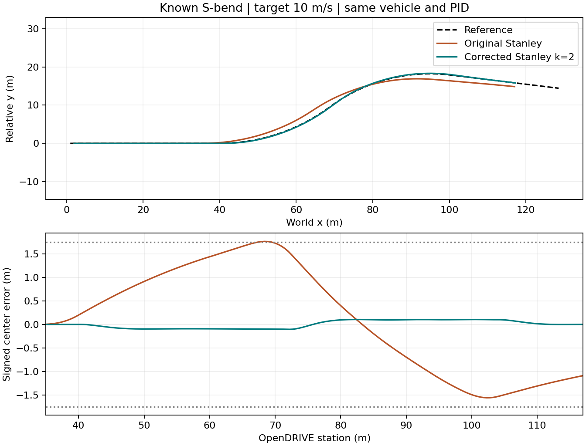

# Stanley 偏差定位与修正

[改进前后实际相机视频](stanley_correction.mp4) · [全精度结果](stanley_reference.json) · [原始证据压缩包](stanley_traces.zip)



## 定位

原实现把车身中心到动态前视点的向量投影到车辆自身的横向方向，再与前视点航向组合。这一数值同时包含前视距离与车辆朝向的影响。原始转向输出的数值为弧度，却直接作为 CARLA 归一化指令使用。新的前轴版本将前轴位置投影到参考折线，用该线段切向定义航向误差，并按前轮最大转角换算指令。两种版本继续使用同一限幅 0.7 和平滑系数 0.4。

在三个开发工况上，固定增益 0.3，分别测试角度换算、几何参考以及两项同时修改。圆弧的横向 RMSE 依次为原实现 1.162 m、只换算角度 1.009 m、只换几何参考约 0.08 m、两项修正约 0.25 m。误差参考方式的影响较大，两个因素存在相互作用。新增的控制律位于 controllers/stanley_tracking.py，通过横向评测入口的 stanley_fixed 模式执行。原实现继续作为回归基线。

## 参数冻结与新工况

对修正后的控制器，仅在直线、65 m 参考线半径圆弧及 55 m S 弯三个开发工况比较增益 0.3、1、2。先比较车身中心越线次数，再比较各工况横向 RMSE 之和，再比较转向指令变化率。按此顺序选中 2.0，随后执行以下测试。

| 工况 | 原 Stanley RMSE / 修正版 (m) | P95 原版 / 修正版 (m) | 中心越线 原版 / 修正版 |
|---|---:|---:|---:|
| 已有留出圆弧，10 m/s | 1.79 / 0.08 | 2.48 / 0.10 | 1 / 0 |
| 已有留出 S 弯，10 m/s | 1.12 / 0.08 | 1.70 / 0.10 | 1 / 0 |
| 新圆弧，6 m/s，参考线半径 80 m | 0.76 / 0.006 | 1.02 / 0.009 | 0 / 0 |
| 新 S 弯，12 m/s，参考线半径 60 / 40 m | 1.13 / 0.14 | 1.68 / 0.21 | 0 / 0 |

新工况在冻结参数后首次执行。原版、修正版和 Pure Pursuit 都运行两次，新工况六组结果的横向 RMSE 最大重复差约 0.00040 m，中心越线次数一致。已有 S 弯的相机复跑也得到原版 1.1215 m、修正版 0.08245 m，在 6.75 s 车身中心偏差分别约 +1.765 m 和 −0.098 m。

## 适用范围

修正版在新 12 m/s S 弯的归一化转向变化率 RMS 约 0.109 /s，原版约 0.088 /s，Pure Pursuit 约 0.062 /s。路径误差降低伴随更活跃的转向操作。场景采用平面、自定义道路及仿真真值，没有噪声、传感器延迟或低附着测试。最大转角换算是当前车辆的简化执行器映射，尚未标定 CARLA 的速度相关转向曲线。误差与中心越线定义沿用[横向评测](lateral.md)，不代表轮胎或车身包络均在车道内。

## 复现

在已有 Windows CARLA 0.9.13 环境中运行。目录需为新目录，地图替换前要求服务器无车辆、行人或传感器。实验结束恢复起始地图。

```powershell
py -3.7 scenarios/run_lateral.py --output output/stanley-ablation --suite development --modes stanley stanley_angle stanley_geometry stanley_fixed --gain 0.3
py -3.7 scenarios/run_lateral.py --output output/stanley-gain-1 --suite development --modes stanley_fixed --gain 1
py -3.7 scenarios/run_lateral.py --output output/stanley-gain-2 --suite development --modes stanley_fixed --gain 2
py -3.7 scenarios/run_lateral.py --output output/stanley-known --modes stanley stanley_fixed pursuit --gain 2
py -3.7 scenarios/run_lateral.py --output output/stanley-new --suite validation --modes stanley stanley_fixed pursuit --gain 2
py -3.7 scenarios/run_lateral.py --output output/stanley-new-repeat --suite validation --modes stanley stanley_fixed pursuit --gain 2
py -3.12 scenarios/report_stanley.py
py -3.7 scenarios/record_lateral.py --fixed --output output/stanley-camera
```

报表脚本从逐帧 CSV 复算指标并检查每次运行到达终点。压缩包内的六个原始运行目录可解压到 output 后离线复算。四项纯 Python 回归测试覆盖误差符号、航向跨越正负 180 度、角度归一化和零速居中输入，已加入 GitHub Actions。
