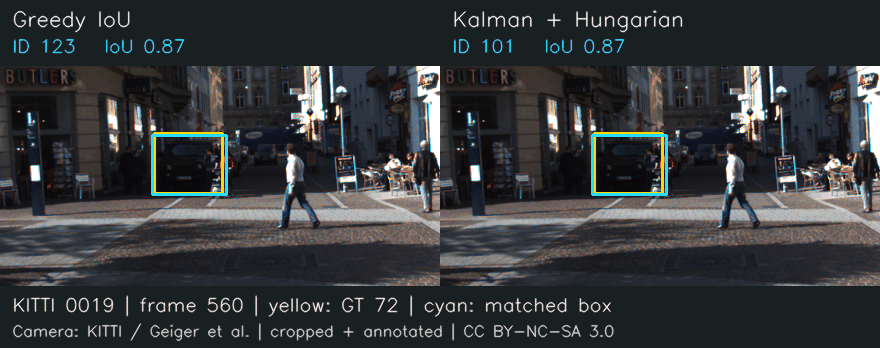
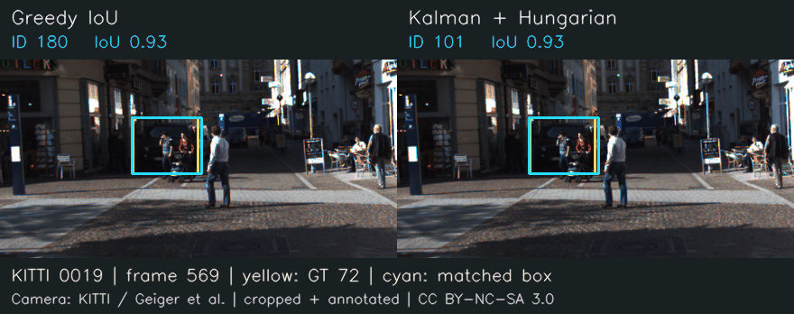

# KITTI 车辆多目标跟踪与感知评测

对同一批 Regionlets 车辆检测框，比较相邻帧贪心 IoU、保留短期轨迹的匈牙利匹配、卡尔曼位置预测加匈牙利匹配。检测来自 KITTI 官方参考结果，跟踪和评测由本项目实现与执行。使用官方页面指定的 TrackEval 1.1.0 KITTI 预处理及 HOTA/CLEAR 指标。[KITTI 数据及评测说明](https://www.cvlibs.net/datasets/kitti/eval_tracking.php) · [TrackEval](https://github.com/JonathonLuiten/TrackEval)

开发集为训练数据中的 0000–0014，留出集为 0015–0020。按整段划分，21 段均使用同一设置，运行留出集前已提交程序为 c595bd8。只评估 Car。两次留出运行的所有跟踪文件字节一致，指标一致。[冻结参数与数据哈希](manifest.json) · [开发结果](development.json) · [留出结果](holdout.json)

## 6 段留出序列，共 2,965 帧

| 方法 | HOTA / % | 关联准确率 AssA / % | IDSW | FP | FN |
|---|---:|---:|---:|---:|---:|
| 相邻帧贪心 IoU | 61.0428 | 60.3802 | 194 | 812 | 1,394 |
| 静态位置 + 匈牙利 + 最多缺失 2 帧 | 62.1613 | 62.5696 | 138 | 812 | 1,394 |
| 卡尔曼 + 匈牙利 + 最多缺失 2 帧 | 62.5423 | 63.3583 | 115 | 812 | 1,394 |

HOTA 采用 TrackEval 跨阈值及序列合并方式。相对基线，完整方法提高约 1.50 个百分点，IDSW 减少 79 次。中间对照同时改变了匹配方式和轨迹保留时间，这两项贡献尚未独立测量；加入卡尔曼预测在中间对照上增加约 0.38 个 HOTA 百分点。FP/FN 相同，因为每帧下发的检测框完全相同，只改变轨迹 ID。当前流程在无检测的帧保留内部状态，输出文件只包含真实检测框。

没有按留出结果调整参数。开发集 0012 上完整方法 HOTA 比基线下降约 7.40 个百分点，保留该退化结果。HOTA 衡量检测、关联和定位的综合表现；本轮涉及给定检测框的 ID 分配。

## 可以逐帧解释的案例



0019 序列真值车辆 72 在帧 563 对应贪心 ID 123、完整方法 ID 101，帧 564 没有匹配检测，565 重新检测到时贪心改成 179，而完整方法续接 101。帧 566–567 再次缺失，568 重新出现时，贪心再分配 180，完整方法仍为 101。静态位置的中间对照同样续接 101，因此该片段支持短期保留的作用。



同一车辆在帧 570–572 没有重叠 IoU 达到 0.5 的检测。连续缺失三帧超过保留期限，573 出现时完整方法从 101 变为 149。画面中车辆前方有人穿行，遮挡与检测间断同时出现。该观察不能单独确认检测器全部漏检原因，未阈值过滤的检测还需另行调查。

回放为左相机原帧的固定裁剪，黄色是真值框，青色是与该真值 IoU ≥ 0.5 的最近检测框。回放中框的身份映射只用于解释该片段，综合指标使用 TrackEval 的匹配和忽略规则。GIF 放慢至每帧 550 ms，KITTI 采样约 10 Hz。图像版权属于 KITTI / Geiger 等，图像经裁剪与叠加标注，按 CC BY-NC-SA 3.0 发布。[数据许可](https://www.cvlibs.net/datasets/kitti/) · [许可条款](https://creativecommons.org/licenses/by-nc-sa/3.0/)

## 实现与复现

检测置信度阈值 0，关联 IoU 门限 0.3。贪心法优先匹配最大 IoU，只续接上一帧。两个匈牙利方法最多容许 2 帧缺失，关联先最大化合格匹配数，再最大化总 IoU。卡尔曼状态为图像框中心位置与每帧速度，固定线性匀速模型。Q=diag(1,1,4,4)，R=diag(4,4)，初始 P=diag(4,4,100,100)。尺寸每次用检测值更新。输出框均使用当帧检测坐标。

TrackEval 的 KITTI 实现处理 Van、DontCare、截断、遮挡和小框，保留默认规则。结果为本地训练数据留出评估。原始测试集无公开真值，未向排行榜提交。代码由 AI 辅助实现，个人独立解释及修改能力待本人演示。

从仓库根目录，在 Python 3.12 环境安装依赖。为离线复算，压缩包保存了真值标注、序列长度和三种方法的逐帧输出，数据及派生标注遵循上述 KITTI 许可。

```bash
python -m pip install trackeval==1.1.0
python -m zipfile -e experiments/kitti_tracking/traces.zip output/kitti/audit
python experiments/kitti_tracking/audit.py output/kitti/audit
python -m unittest discover -s experiments/kitti_tracking -p test_tracking.py -v
```

重新跟踪只需下载官方标注及参考检测文件，保存到 D 盘的 output/kitti。无需下载完整图像集即可计算指标。

```powershell
$source = 'https://s3.eu-central-1.amazonaws.com/avg-kitti'
New-Item -ItemType Directory -Force output/kitti | Out-Null
Invoke-WebRequest "$source/data_tracking_label_2.zip" -OutFile output/kitti/labels.zip
Invoke-WebRequest "$source/data_tracking_det_2_regionlets.zip" -OutFile output/kitti/regionlets.zip
python experiments/kitti_tracking/evaluate.py output/kitti output/kitti/study development
python experiments/kitti_tracking/evaluate.py output/kitti output/kitti/study holdout
python experiments/kitti_tracking/audit.py output/kitti/study
```

若有原始左相机 0019 的帧 560–578，可用下列命令重生成两个案例。完整图像包为 data_tracking_image_2.zip。项目交付的 GIF 对应这 19 帧。

```bash
python experiments/kitti_tracking/replay.py PATH_TO_IMAGE_02/0019 output/kitti/study/holdout output/kitti/replay
```
