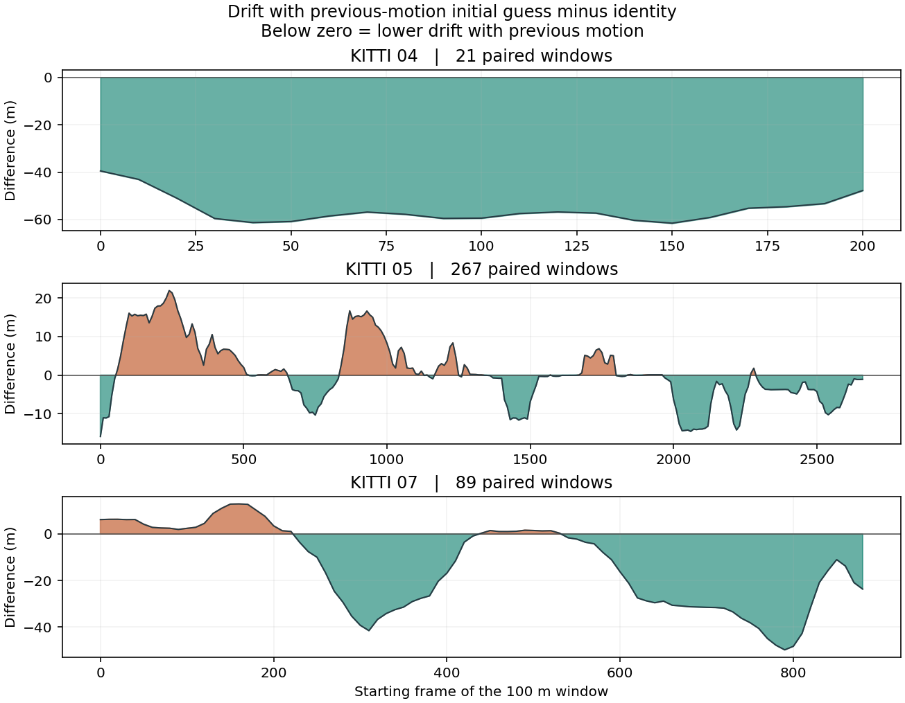

# KITTI 激光里程计与定位误差评测

在 KITTI Odometry 04、05、07 的完整点云序列中，固定 1.0 m 体素，比较两种点到点 ICP 初值。每个约 100 m 的路段使用相同的起止帧，三条序列共 377 个重叠窗口。下表箭头从单位变换初值指向上一帧运动初值。

| 序列 | 平均漂移（m / 100 m） | 全程位置 RMSE（m） | 漂移改善 / 退化窗口数 |
|---|---:|---:|---:|
| 04 | 77.62 → 21.89 | 157.70 → 52.39 | 21 / 0 |
| 05 | 8.55 → 9.16 | 55.18 → 73.54 | 140 / 127 |
| 07 | 24.04 → 9.99 | 34.81 → 36.70 | 56 / 33 |

07 的第 780–871 帧，换初值后路段误差从 54.24 m 降到 6.44 m。第 160–289 帧则从 6.75 m 升到 19.66 m。局部漂移从每段起点重新计量，全程 RMSE 从序列首帧对齐，因此能观察到局部平均改善、全程误差上升。05 中多数窗口改善，平均漂移却上升，退化的幅度也影响验收结论。以上为三条已分析路线上的回顾性比较。



[377 段逐项对照](evidence/segments.csv) · [各序列实测指标](evidence/metrics.json) · [C++ 配准](odometry.cpp) · [Python 配对评测](compare_initial_guesses.py)

## 在 Linux 复现三序列对照

在仓库根目录使用 Bash，环境为 C++17、CMake、PCL 1.14、Python 3.12、NumPy 和 Matplotlib。下方命令使用当前目录保存官方数据、编译文件和运行结果。已有数据时可直接把 `data` 指向含有 `poses` 和 `sequences` 的目录。

```bash
set -e
src=experiments/lidar_odometry
data="$PWD/data/kitti/dataset"
out=output/lidar-odometry
build=build/lidar-odometry
python3 "$src/fetch_kitti.py" "$(dirname "$data")" --sequences 04 05 07
cmake -S "$src" -B "$build" -DCMAKE_BUILD_TYPE=Release
cmake --build "$build" -j2
ctest --test-dir "$build" --output-on-failure
mkdir -p "$out/sequence-04"
for mode in identity motion; do
  file=04_1.0.csv
  if [ "$mode" = motion ]; then file=04_motion_1.0.csv; fi
  "$build/odometry" "$data/sequences/04/velodyne" "$mode" "$out/sequence-04/$file" --segment 0 270 1.0
  for seq in 05 07; do
    "$build/odometry" "$data/sequences/$seq/velodyne" "$mode" "$out/${seq}_${mode}.csv"
  done
done
MPLBACKEND=Agg python3 "$src/compare_initial_guesses.py" "$data" "$out"
```

## 配准实现

Ubuntu 24.04、PCL 1.14、Eigen、C++17。每帧使用激光坐标，保留水平半径 2–40 m、高度 −2.5 至 4 m 的点，按 1 m 体素降采样。点到点 ICP 将当前帧对齐到前一帧，最大对应距离 2.5 m，最多迭代 25 次。累积位姿时旋转用归一化四元数。合成测试用已知平移与绕 Z 轴旋转检查变换方向。

## 冻结与评测

开发序列 05 对照单位初值和上一帧相对运动初值。选择先看配准失败次数，再取平均 100 m 路段平移漂移较低者。选定后以相同滤波、ICP 参数和初值策略运行序列 07。PCL 报告未收敛时将本步位姿保持在上一帧，统计失败并保留这一帧的轨迹误差。收敛标志本身不能证明配准正确。

KITTI 真值为首帧相机坐标下的相机位姿。用标定文件中的 Tr 将累计激光位姿共轭转换到相机系，两条轨迹仅首帧对齐，不做全局拟合。每隔 10 帧取一个起点，以累计真值距离首次超过 100 m 的帧作为终点，计算该段相对位姿平移误差，除以名义 100 m，报告各段均值。该指标只包含 100 m 长度。平移 RMSE 按所有帧空间位置计算。P95 分别记录匹配耗时以及本机读盘、滤波、匹配和位姿更新总耗时，均排除无前帧可匹配的首帧。

## 复跑

从 KITTI 官方 Odometry 数据包提取 05、07 的激光扫描、标定与真值。下载器检查字节范围和每个 ZIP 成员的 CRC，可复用已校验的文件。数据仅放本机。[KITTI Odometry](https://www.cvlibs.net/datasets/kitti/eval_odometry.php)

在 Windows 的仓库根目录执行以下命令。运行环境为 Windows Python 3.12（NumPy、Matplotlib）和 WSL Ubuntu-24.04（g++、CMake、PCL）。输出目录和编译目录使用 D 盘。

```powershell
py -3.12 -B experiments/lidar_odometry/fetch_kitti.py D:/AIData/Datasets/kitti-odometry
wsl -d Ubuntu-24.04 -- cmake -S project/experiments/lidar_odometry -B tmp/pcl-build -DCMAKE_BUILD_TYPE=Release
wsl -d Ubuntu-24.04 -- cmake --build tmp/pcl-build -j2
wsl -d Ubuntu-24.04 -- ctest --test-dir tmp/pcl-build --output-on-failure
./experiments/lidar_odometry/run_study.ps1 -Dataset D:/AIData/Datasets/kitti-odometry/dataset -Output output/lidar-odometry -Build tmp/pcl-build
```

两套开发轨迹与选择规则的输出为 development.json，留出指标为 holdout.json。07 上选取 100 m 路段相对平移误差最大的一段，并从段内取 ICP fitness 最大的帧对画叠图。该帧用于复核，不单独推定整段漂移的原因。

在 WSL 工作区根目录，打开两个终端，均先执行 `source /opt/ros/jazzy/setup.bash` 和 `export ROS_DOMAIN_ID=57`。先启动 `rviz2 -d experiments/lidar_odometry/odometry.rviz`，再运行：

```bash
python3 experiments/lidar_odometry/rviz_replay.py /mnt/d/AIData/Datasets/kitti-odometry/dataset output/lidar-odometry/07_replay.npz
```

灰色点为激光扫描，绿色为真值，橙色为估计轨迹。两条路径共用局部显示原点，保留绝对偏差。
